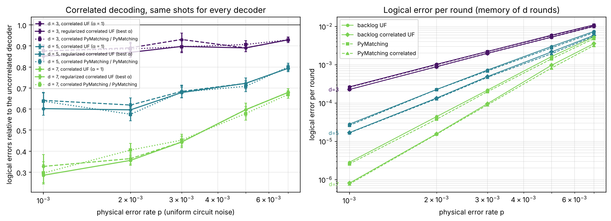
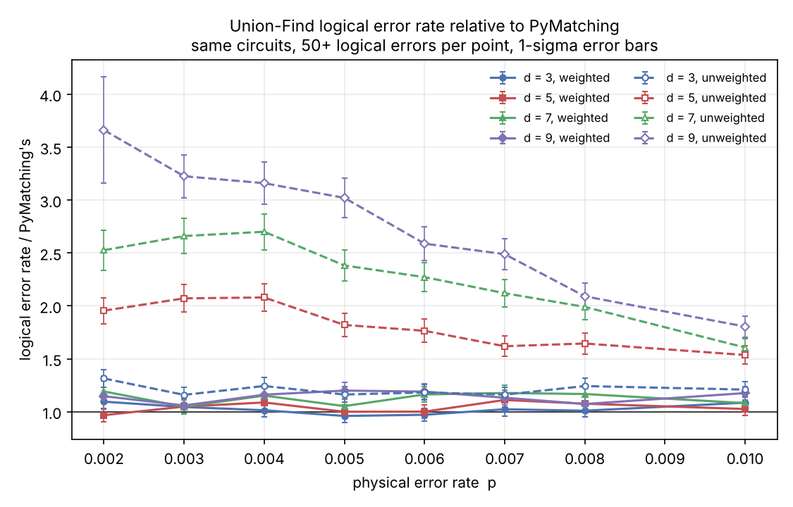
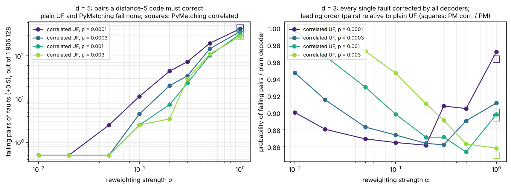
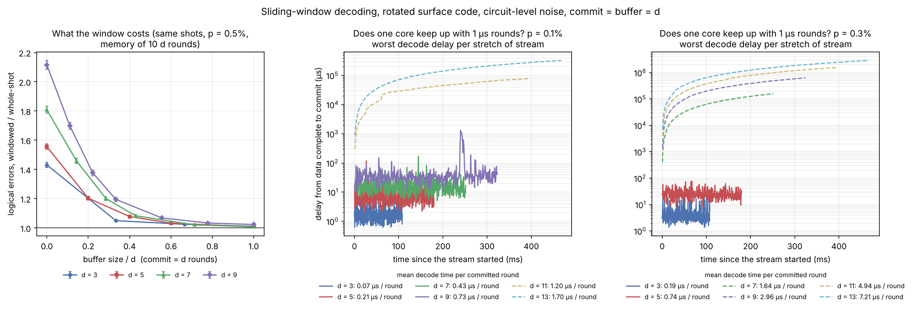
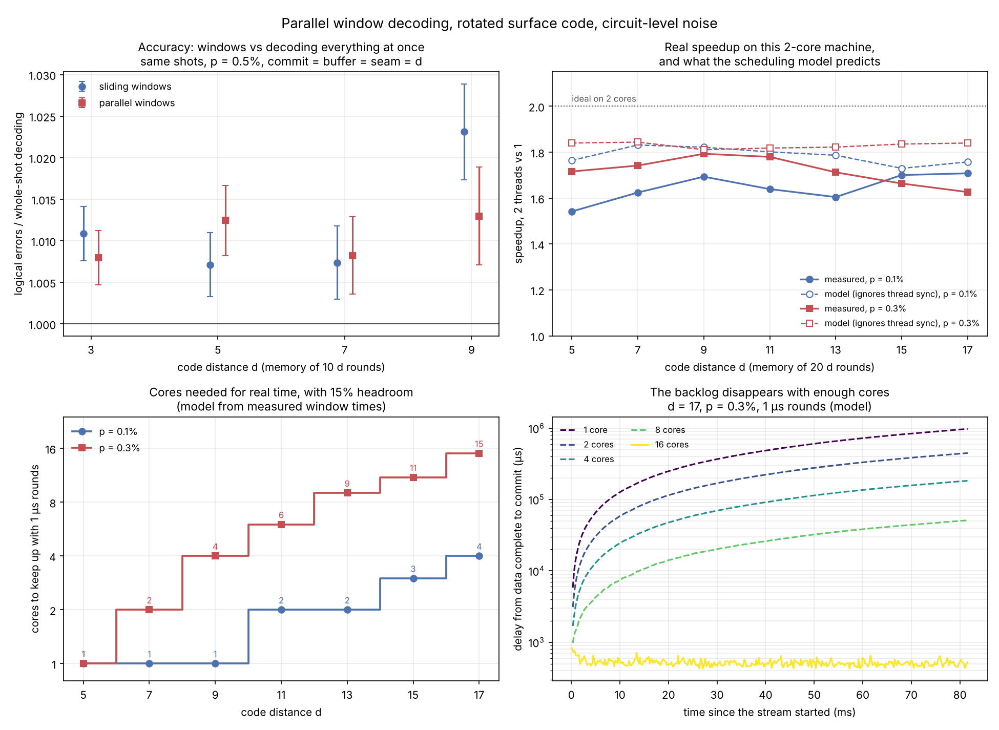
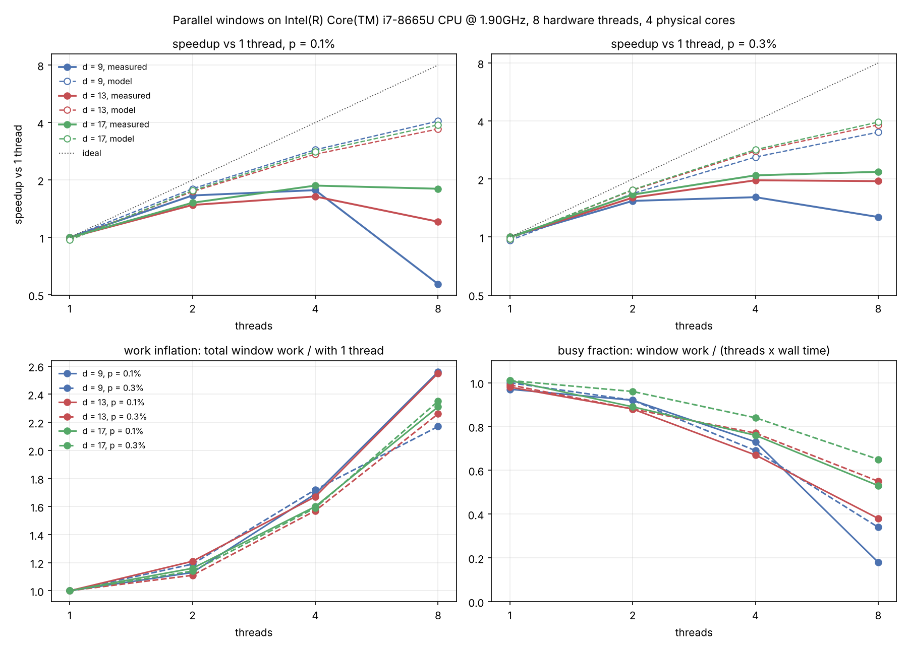
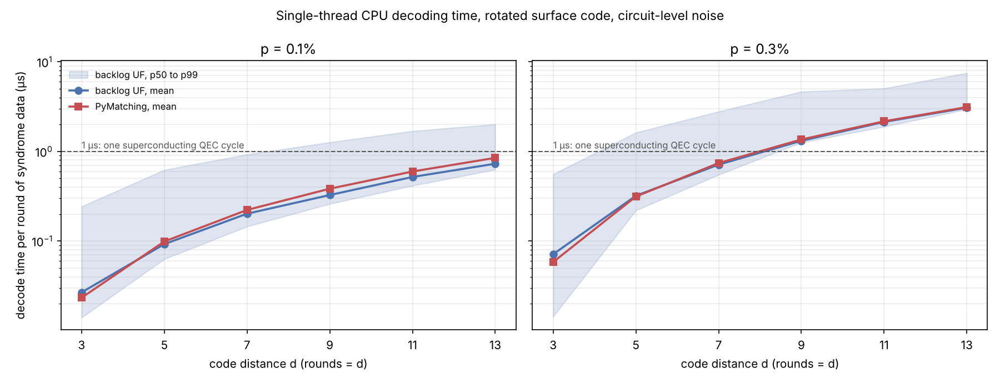

# backlog

[](https://github.com/jcedrik/backlog/actions/workflows/ci.yml)
[](pyproject.toml)
[](LICENSE)
[](https://pypi.org/project/backlog-qec/)
[](#distance-effective--chaque-paire-de-fautes-décodée)

**Un décodeur de correction d'erreurs quantiques temps réel, bâti de zéro :
de la simulation jusqu'au FPGA.**

Union-Find pondéré pour le surface code, aussi rapide que PyMatching sur un
cœur ; décodage corrélé à quelques pour cent du « correlated matching » de
PyMatching, et plus rapide à grande distance ; décodeurs en fenêtres
glissantes et parallèles ; intégration Stim et sinter ; un cœur VHDL vérifié
bit à bit contre le C++.

[English version](README.md) · [Notebook de démarrage](examples/quickstart.ipynb) · [Historique](CHANGELOG.md) ·
[Fonctionnement](docs/decoder.md) · [État de l'art](docs/related-work.md)

```bash
pip install backlog-qec   # wheels pour Linux, macOS (Apple Silicon) et Windows
```

```python
import backlog, stim

circuit = stim.Circuit.generated("surface_code:rotated_memory_z", distance=5, rounds=5,
                                 after_clifford_depolarization=0.003)
dets, obs = circuit.compile_detector_sampler().sample(100_000, separate_observables=True)

decoder = backlog.UnionFindDecoder.from_circuit(circuit, correlated=True)
print("taux d'erreur logique :", (decoder.decode_batch(dets) != obs).any(axis=1).mean())
```

## Nouveau dans la v0.5

- **Union-Find corrélé.** Deux passes, comme `enable_correlations` de
  PyMatching : les arêtes de la première correction rendent moins chères
  leurs partenaires dans les erreurs décomposées (les moitiés X et Z d'une
  erreur Y), puis le décodeur repasse. Sur les mêmes tirages, il fait 7 à
  12 % moins d'erreurs logiques qu'Union-Find simple à d = 3, 21 à 38 % de
  moins à d = 5, 32 à 67 % de moins à d = 7, et moins que PyMatching simple
  partout. Le facteur de suppression d'erreur Λ passe de 3,3 à 5,2 à
  p = 0,3 %.
- **Un résultat d'octobre 2026, reproduit sur un décodeur Union-Find.** Le
  décodage corrélé standard perd une unité de distance loin sous le seuil
  ([Hernando de la Fuente et al., arXiv:2610.26785](https://arxiv.org/abs/2610.26785),
  Leiden et Riverlane). En décodant les 1,9 million de paires de fautes du
  circuit d = 5 : Union-Find simple et PyMatching n'en ratent aucune ;
  Union-Find corrélé en rate 284 à 425, le « correlated matching » de
  PyMatching 281 à 440 ; la règle régularisée de l'article ramène ça à zéro.
- **Une trouvaille pratique : la décomposition compte.** Avec la
  décomposition de Stim, le décodage corrélé à d = 3 et p = 0,1 % fait 44 %
  *plus* d'erreurs logiques que le décodage simple, pour PyMatching comme
  pour backlog. Couper chaque erreur en exactement sa partie X et sa partie Z
  (`backlog.decompose_by_basis`, maintenant le défaut) en fait un gain, et
  fait passer le gain à d = 5 de 28 % à 46 %. Signalé à PyMatching :
  [PyMatching#193](https://github.com/oscarhiggott/PyMatching/issues/193) ;
  pourquoi ça arrive et comment vérifier votre propre montage :
  [l'article (en anglais)](docs/correlated-decoding-decomposition.md).
- **Fenêtres parallèles sans barrière.** Une couture démarre dès que ses deux
  fenêtres « cœur » ont commité, les threads inactifs font une pause au lieu
  de marteler un hyperthread, et `make scaling` sépare maintenant
  l'accélération en inflation du travail et en temps d'attente.
- **Facile à prendre en main.** `pip install backlog-qec` (wheels pour
  Linux, macOS et Windows), un [notebook de démarrage](examples/quickstart.ipynb),
  des [notes pour contribuer](CONTRIBUTING.md) et un
  [fichier de citation](CITATION.cff).



## Pourquoi « backlog »

Un ordinateur quantique tolérant aux fautes doit décoder les erreurs plus vite
qu'elles apparaissent. Si le décodeur est plus lent que le flux de syndromes,
le retard s'accumule et le calcul ralentit de façon exponentielle. Sur une
puce supraconductrice, un cycle de correction dure environ 1 microseconde :
le décodeur a donc un budget temps réel strict. Ce projet construit un
décodeur pour ce problème, le mesure honnêtement à chaque étape, montre le
retard qui s'accumule quand un seul cœur décroche, et le fait disparaître
avec des fenêtres en parallèle. Où il se situe parmi les décodeurs publiés
(Google, Riverlane, Micro Blossom, Helios, NVIDIA, AlphaQubit 2) :
[docs/related-work.md](docs/related-work.md) (en anglais).

## Résultats

Toutes les expériences : mémoires sur surface code rotatif générées par Stim,
d rondes sauf mention contraire, chaque canal de bruit à p (bruit uniforme au
niveau circuit). Les barres d'erreur valent un écart-type.

### Précision et vitesse face à PyMatching

Par sinter sur les mêmes circuits : 12,8 millions de tirages, 96 points, au
moins 68 erreurs logiques par point.

| | PyMatching 2 (MWPM) | UF backlog, pondéré | UF backlog, non pondéré |
|---|---|---|---|
| croisement de d = 7 et d = 9 | 0,75 ± 0,02 % | 0,77 ± 0,03 % | 0,66 ± 0,04 % |
| taux d'erreur logique relatif à PyMatching, d = 3 et 5 | 1 | 0,96 à 1,11 | 1,16 à 2,08 |
| taux d'erreur logique relatif à PyMatching, d = 7 et 9 | 1 | 1,05 à 1,20 | 1,61 à 3,66 |
| vitesse relative à PyMatching, d = 3 | 1 | 0,82 à 0,87 | |
| vitesse relative à PyMatching, d = 5 à 13, p = 0,1 % | 1 | 1,02 à 1,19 | |
| vitesse relative à PyMatching, d = 5 à 13, p = 0,3 % | 1 | 0,98 à 1,04 | |

- **C'est la pondération qui rend Union-Find compétitif.** Faire croître
  chaque arête selon sa log-vraisemblance fait passer Union-Find de jusqu'à
  3,7 fois le taux d'erreur logique de PyMatching à 0 à 20 % de plus, avec le
  même seuil à l'intérieur des barres d'erreur.
- **Vitesse : à égalité avec PyMatching 2, pas une raclée.** Sur un cœur, ce
  décodeur est 15 à 19 % plus rapide à p = 0,1 % à partir de d = 9, à égalité
  à p = 0,3 %, et plus lent à d = 3 (les reprises concordent à environ 5 %
  près).



### Décodage corrélé

Tous les décodeurs voient les mêmes tirages (jusqu'à 6 millions par point,
au moins 32 erreurs logiques pour chaque décodeur), donc les rapports ont des
barres d'erreur appariées. Erreurs logiques d'Union-Find corrélé divisées par
celles d'Union-Find simple :

| | p = 0,1 % | 0,2 % | 0,3 % | 0,5 % | 0,7 % |
|---|---|---|---|---|---|
| d = 3 | 0,88 ± 0,03 | 0,89 ± 0,03 | 0,93 ± 0,03 | 0,89 ± 0,02 | 0,93 ± 0,01 |
| d = 5 | 0,64 ± 0,04 | 0,62 ± 0,03 | 0,68 ± 0,03 | 0,72 ± 0,03 | 0,79 ± 0,02 |
| d = 7 | 0,33 ± 0,05 | 0,36 ± 0,03 | 0,44 ± 0,03 | 0,60 ± 0,03 | 0,68 ± 0,02 |

Le « correlated matching » de PyMatching gagne à peu près autant face à
PyMatching simple. Union-Find corrélé finit 1 à 22 % au-dessus de PyMatching
corrélé (6 % au point médian), à peu près le même écart qu'entre les deux
décodeurs simples. Suppression d'erreur, Λ = erreur logique par ronde à
d = 5 / à d = 7 :

| p | Union-Find | UF corrélé | PyMatching | PyMatching corrélé |
|---|---|---|---|---|
| 0,1 % | 9,9 | 19 | 10,1 | 22 |
| 0,2 % | 5,1 | 8,7 | 6,0 | 8,5 |
| 0,3 % | 3,3 | 5,2 | 3,5 | 5,3 |
| 0,5 % | 1,8 | 2,2 | 1,9 | 2,4 |

(À p = 0,1 %, les points d = 7 reposent sur 32 à 119 erreurs logiques, donc
ces Λ sont bons à 10 à 20 % près.) Le décodage corrélé coûte environ 3 fois
le temps d'une passe, pour les deux décodeurs ; Union-Find corrélé est à
10 % près de PyMatching corrélé à d = 5 et 9, et plus rapide à partir de
d = 13 (4,2 contre 5,8 µs par ronde à d = 17, p = 0,1 %).
[Fonctionnement](docs/decoder.md#9-correlated-decoding).

### Distance effective : chaque paire de fautes, décodée

Un code de distance d doit corriger tout ensemble de (d-1)/2 fautes.
Hernando de la Fuente et al. ont montré que le décodage corrélé standard ne
le fait pas : une arête de la première passe peut réduire le coût de
plusieurs arêtes partenaires à la fois, comme si leur occurrence conjointe
était gratuite. `make faults` le vérifie exhaustivement, sur chaque paire de
fautes du circuit d = 5 (1 906 128 paires) :

| d = 5, paires mal décodées | p = 10⁻⁴ | 3·10⁻⁴ | 10⁻³ | 3·10⁻³ |
|---|---|---|---|---|
| Union-Find, PyMatching | 0 | 0 | 0 | 0 |
| Union-Find corrélé, α = 1 | 425 | 367 | 320 | 284 |
| PyMatching corrélé | 440 | 361 | 311 | 281 |
| Union-Find corrélé, α = 0,1 | 11 | 4 | 2 | 2 |
| Union-Find corrélé, α = 0,05 | 2 | 0 | 0 | 0 |



La règle régularisée multiplie chaque probabilité conditionnelle par α ≤ 1.
Un petit α rend la distance mais abandonne une partie de la vraie
corrélation, donc le meilleur α dépend de p : les simulations Monte Carlo et
l'énumération exacte à d = 3 suivent toutes deux la forme de l'article,
α*(p) = 1 / (1 + 10⁻³/p) (`backlog.regularization_strength(p)`) : environ
0,5 à p = 0,1 %, et vers 0,1 à 10⁻⁴, là où la distance perdue dominerait.

### Flux continu : le backlog, mesuré



Un décodeur temps réel ne peut pas attendre la fin de l'expérience.
`SlidingWindowDecoder` décode `commit + buffer` rondes à la fois, garde la
correction des `commit` rondes les plus vieilles, reporte son effet vers
l'avant et glisse ([fonctionnement](docs/decoder.md#7-sliding-windows-decoding-as-the-rounds-arrive)).

- **À gauche : un buffer de d rondes suffit.** Sur les mêmes tirages, il
  donne 0,7 à 2,3 % plus d'erreurs logiques que le décodage de l'expérience
  complète d'un coup (d = 3 à 9, p = 0,5 %, 10 d rondes). Sans buffer : 1,4 à
  2,1 fois plus.
- **Au milieu et à droite : un cœur suit-il ?** Les rondes arrivent à chaque
  microseconde, et un seul cœur décode les fenêtres dans l'ordre, chacune
  mesurée en C++. Les traits pleins restent bornés : le décodeur suit. Les
  pointillés croissent sans limite : c'est le backlog.

| p | suit jusqu'à | travail par ronde commitée | premier à décrocher |
|---|---|---|---|
| 0,1 % | d = 9 | 0,73 µs | d = 11 (1,20 µs) |
| 0,3 % | d = 5 | 0,74 µs | d = 7 (1,64 µs) |

Le flux continu coûte environ deux fois le travail du décodage entier par
ronde, puisque chaque ronde est décodée une fois dans un buffer et une fois
dans une région de commit. Suivre en moyenne ne dit pas tout non plus : à
d = 9 et p = 0,1 %, le cœur est occupé 73 % du temps, et une rafale de
fenêtres difficiles a poussé un délai jusqu'à 1,3 ms.

### Fenêtres en parallèle : plus de cœurs, plus de backlog



`ParallelWindowDecoder` décode les fenêtres « cœur » (commit de d rondes,
buffer de d de chaque côté) en parallèle, et chaque couture entre deux
fenêtres cœur dès que les deux ont commité
([fonctionnement](docs/decoder.md#8-parallel-windows-more-cores-no-backlog)).

- **En haut à gauche : aucune précision perdue.** 0,8 à 1,3 % plus d'erreurs
  logiques que le décodage entier sur les mêmes tirages, comme les fenêtres
  glissantes.
- **En haut à droite : accélération réelle.** 2 threads vont 1,54 à 1,79 fois
  plus vite qu'un seul sur cette machine à 2 cœurs (d = 5 à 17). Un modèle
  d'ordonnancement bâti sur le temps mesuré de chaque fenêtre prédit le temps
  à 2 threads à 1 à 13 % près (il ignore la synchronisation, donc il est un
  peu optimiste).
- **En bas : combien de cœurs pour le temps réel.** Le modèle sur un flux de
  rondes de 1 µs, avec 15 % de marge pour son optimisme :

| d | 9 | 11 | 13 | 15 | 17 |
|---|---|---|---|---|---|
| cœurs, p = 0,1 % | 1 | 2 | 2 | 3 | 4 |
| cœurs, p = 0,3 % | 4 | 6 | 9 | 11 | 15 |

Avec moins de cœurs, le délai croît sans limite (en bas à droite, d = 17) ;
avec ceux-là, il reste sous environ une milliseconde. Le prix est la latence :
la ronde la plus vieille d'une couture attend environ 3 d rondes de données
avant que son commit puisse commencer.

**Mesuré sur un vrai portable à 4 cœurs** (Intel i7-8665U, 15 W, Ubuntu sous
WSL2, `make scaling`), le modèle ne tient plus au-delà de 2 threads, et les
nouveaux compteurs disent pourquoi :



| threads | accélération | modèle | inflation du travail | occupé |
|---|---|---|---|---|
| 2 | 1,48 à 1,66 | 1,68 à 1,80 | 1,11 à 1,21 | 88 à 96 % |
| 4 | 1,61 à 2,09 | 2,60 à 2,88 | 1,57 à 1,72 | 67 à 84 % |
| 8 | 0,57 à 2,18 | 3,50 à 4,07 | 2,17 à 2,56 | 18 à 65 % |

L'accélération vaut threads × fraction occupée / inflation du travail. Avec 4
threads, un par cœur physique, les mêmes fenêtres prennent 1,6 à 1,7 fois
plus de temps qu'avec un seul : ça plafonne à lui seul l'accélération entre
2,3 et 2,5, avant toute attente. L'inflation ne grandit pas avec la taille des
fenêtres (une fenêtre à d = 17 a 7 fois plus de détecteurs qu'à d = 9), ce
qui pointe vers l'horloge d'une puce de 15 W avec quatre cœurs occupés plutôt
que vers les mémoires cache : partager les graphes des fenêtres entre threads
ne la réduirait pas. Les threads sont occupés 67 à 84 % du temps, soit ce que
permet l'ordonnancement d'un tirage complet (le modèle, sans aucun coût de
synchronisation, obtient 65 à 72 %) : l'ordonnanceur lui-même ne coûte rien
de mesurable. Avec 8 threads, deux hyperthreads partagent chaque cœur et chaque
fenêtre prend 2,2 à 2,6 fois plus de temps : aucun gain sur 4. Par rapport à
la v0.4 sur le même portable, 8 threads sont passés de 0,92-1,99x à
1,21-2,18x à d ≥ 13 ; à 4 threads, c'est dans l'écart d'une reprise à l'autre
(1,6 à 2,1 les deux fois). Les nombres de cœurs ci-dessus sont donc des
bornes inférieures pour ce genre de machine : le temps réel à grande échelle
demande des cœurs qui gardent leur fréquence sous charge (un serveur, un
thread épinglé par cœur physique) ou du matériel dédié.

### Débit sur des expériences complètes



Un thread, Intel Xeon à 2,1 GHz (VM infonuagique à 2 cœurs), 20 000 tirages
par point, expériences mémoire complètes de d rondes :

| d | p | UF p50 | UF p99 | UF moyenne | PyMatching moyenne |
|---|---|---|---|---|---|
| 5 | 0,1 % | 0,32 µs | 3,1 µs | 0,46 µs | 0,49 µs |
| 9 | 0,1 % | 2,3 µs | 11,4 µs | 2,9 µs | 3,5 µs |
| 13 | 0,1 % | 8,2 µs | 26,1 µs | 9,5 µs | 11,0 µs |
| 5 | 0,3 % | 1,1 µs | 8,1 µs | 1,6 µs | 1,6 µs |
| 9 | 0,3 % | 11,3 µs | 41,9 µs | 11,8 µs | 12,2 µs |
| 13 | 0,3 % | 38,4 µs | 97,6 µs | 40,0 µs | 40,7 µs |

### Matériel (v0 : 1D, non pondéré)

Cœur Union-Find en VHDL, exact bit à bit contre son modèle de référence sur
plus de 6 000 vecteurs (N = 8, 16, 32). Après placement-routage sur un iCE40
HX8K : 94,5 MHz à N = 8, environ 10,6 ns par ronde de croissance. La Fmax
baisse avec N, et la cause est identifiée : des chaînes XOR en série, à
remplacer par un préfixe parallèle. [Détails](hardware/README.md).

## Utilisation

```bash
pip install backlog-qec   # ou la toute dernière : pip install git+https://github.com/jcedrik/backlog
```

```python
import stim
import backlog

p = 0.003
circuit = stim.Circuit.generated(
    "surface_code:rotated_memory_z", distance=5, rounds=50,
    after_clifford_depolarization=p, before_round_data_depolarization=p,
    before_measure_flip_probability=p, after_reset_flip_probability=p)
dets, obs = circuit.compile_detector_sampler().sample(20_000, separate_observables=True)

decoder = backlog.UnionFindDecoder.from_circuit(circuit)  # pondéré par défaut
print("simple :", (decoder.decode_batch(dets) != obs).any(axis=1).mean())

# Corrélé (deux passes) ; alpha < 1 est la règle régularisée d'arXiv:2610.26785
corr = backlog.UnionFindDecoder.from_circuit(
    circuit, correlated=True, alpha=backlog.regularization_strength(p))
print("corrélé :", (corr.decode_batch(dets) != obs).any(axis=1).mean())

# Flux continu : 5 rondes commitées par fenêtre, 5 rondes de buffer
window = backlog.SlidingWindowDecoder.from_circuit(circuit, commit=5, buffer=5, correlated=True)
print("fenêtres :", (window.decode_batch(dets) != obs).any(axis=1).mean())

# Fenêtres parallèles sur 2 threads (même réponse peu importe le nombre de threads)
parallel = backlog.ParallelWindowDecoder.from_circuit(circuit, commit=5, buffer=5, threads=2)
print("parallèle :", (parallel.decode_batch(dets) != obs).any(axis=1).mean())
```

Comme décodeurs sinter (`backlog-uf`, `backlog-uf-corr`,
`backlog-uf-unweighted`), depuis Python :

```python
stats = sinter.collect(
    num_workers=4, tasks=tasks, decoders=["backlog-uf-corr", "uf-window"], max_shots=10**6,
    custom_decoders={**backlog.sinter_decoders(),
                     "uf-window": backlog.SinterSlidingWindowDecoder(commit=5, buffer=5)})
```

ou en ligne de commande :

```bash
sinter collect --circuits circuit.stim --decoders backlog-uf-corr pymatching \
    --custom_decoders_module_function "backlog:sinter_decoders" \
    --max_shots 100000 --processes 4 --save_resume_filepath stats.csv
```

Vous utilisez le « correlated matching » de PyMatching sur un circuit Stim ?
Décomposez le modèle avec `backlog.decompose_by_basis(dem)` plutôt qu'avec
`decompose_errors=True` de Stim : c'est cette décomposition qui rend les
corrélations payantes (voir plus haut, et [PyMatching#193](https://github.com/oscarhiggott/PyMatching/issues/193)).

## Reproduire

```bash
pip install -r requirements.txt && make install   # dans un virtualenv
make test        # tests C++ et fuzzing, pytest, vérifications en ligne de commande
make mutants     # test par mutation, environ dix minutes
make tsan        # tests C++ sous ThreadSanitizer
make faults      # chaque paire de fautes à d = 3 et 5, chaque décodeur (~6 min)
make correlated  # corrélé contre simple contre PyMatching, mêmes tirages (~15 min sur 2 cœurs)
make compare     # balayage PyMatching contre Union-Find avec sinter (long, reprenable)
make streaming   # fenêtres glissantes : précision, latence, backlog (quelques minutes)
make parallel    # fenêtres parallèles : précision, accélération, cœurs nécessaires
make scaling     # accélération, inflation du travail et attente avec 1, 2, 4, ... threads
make latency     # temps de décodage des expériences complètes, sur une machine au repos
make hw-sim      # simulation VHDL, exacte bit à bit (demande ghdl)
make hw          # synthèse VHDL, placement-routage (demande yosys, nextpnr-ice40)
make help        # tout le reste
```

## Comment la justesse est vérifiée

1. **Chaque correction est valide.** Elle doit reproduire le syndrome
   observé. C'est vérifié à chaque décodage dans chaque test, et le décodeur
   en ligne de commande sort en erreur s'il échoue une seule fois.
2. **Rapide égale référence.** `ReferenceDecoder` est une version courte,
   synchrone et évidemment correcte de l'algorithme. Le décodeur rapide,
   piloté par événements, doit rendre la même correction, arête pour arête :
   75 000 cas aléatoires sur des graphes au hasard (arêtes parallèles
   comprises), plus de vrais modèles de surface code.
3. **Le décodage corrélé est le décodeur sur le graphe repondéré.** Sur
   75 000 cas aléatoires avec des règles de repondération au hasard, la
   deuxième passe doit égaler le décodeur de référence lancé sur le graphe
   explicitement repondéré, arête pour arête, avec un seul décodeur réutilisé
   d'un tirage à l'autre (les poids et l'ordre des listes d'adjacence doivent
   donc revenir après chaque tirage).
4. **Les fenêtres sont vérifiées de la même façon.** Sur 75 000 graphes en
   couches aléatoires par décodeur à fenêtres, dont la moitié corrélés, les
   corrections commitées reproduisent toujours le syndrome, et une fenêtre
   couvrant toutes les rondes donne exactement la réponse du décodage entier.
   Le décodeur parallèle doit donner la même correction avec 1 et 3 threads,
   et la suite passe sans erreur sous ThreadSanitizer.
5. **Les tests attrapent les bogues.** `make mutants` injecte 26 bogues
   réalistes un à la fois (mauvais taux de croissance, rayon perdu à la
   fusion, flips non reportés, couture démarrée avant ses deux fenêtres cœur,
   poids non restaurés après un tirage corrélé, arête allégée laissée mal
   placée dans l'adjacence triée...) et exige que la suite échoue pour
   chacun. Elle échoue, 26 sur 26.
6. **La précision et la distance sont surveillées.** pytest échoue si
   Union-Find pondéré dépasse 1,35 fois le taux d'erreur logique de
   PyMatching à d = 5, p = 0,5 %, si le décodage corrélé n'enlève pas au
   moins 15 % des erreurs à d = 5 ou s'éloigne de plus de 15 % de PyMatching
   corrélé, si un buffer de d rondes coûte plus de 5 %, ou si, parmi les
   1,9 million de paires de fautes à d = 5, Union-Find simple ou la règle
   régularisée en rate une seule.
7. **Matériel.** Le banc de test VHDL compare chaque sortie au modèle de
   référence bit à bit, et vérifie l'invariant du syndrome de façon
   indépendante.

Tout ça roule en CI à chaque push, et les suites C++ et Python roulent aussi
sur macOS (Apple Clang) et Windows (MSVC).

## Organisation

```
src/backlog/   paquet Python : conversion du modèle d'erreur, corrélations, décodeurs, plugin sinter
cpp/           cœur C++17 (sans dépendance) : décodeurs rapide, de référence, corrélé, à
               fenêtres glissantes et parallèles, tests, CLI, bindings
tests/         pytest : seuils de précision, décodage corrélé, fenêtres, intégration sinter
python/        expériences : balayages, benchmarks, énumération des fautes, figures
examples/      notebook de démarrage
hardware/      cœur VHDL 1D : modèle de référence, RTL, banc de test, synthèse, placement-routage
scripts/       vérifications en ligne de commande, test par mutation
results/       données et figures produites par les scripts
docs/          fonctionnement du décodeur, état de l'art, feuille de route (en anglais)
```

## Limites

- **Passage à l'échelle mesuré sur un portable seulement.** Sur un portable
  à 4 cœurs et 15 W, l'accélération plafonne vers 2x à 4 threads, surtout
  parce que chaque cœur ralentit quand les autres travaillent ; les nombres
  de cœurs ci-dessus restent des bornes inférieures tant que `make scaling`
  n'a pas roulé sur un serveur avec des cœurs dédiés. Le flux rejoue des
  fenêtres mesurées sur des tirages indépendants, une approximation d'une
  seule longue expérience.
- **Un seul modèle de bruit.** Tous les chiffres ici sont pour un bruit
  uniforme au niveau circuit ; les constantes de régularisation en
  particulier sont à réajuster pour un autre modèle (SI1000, modèle tiré du
  matériel).
- **α est un paramètre.** Le décodeur ne connaît pas le taux d'erreur
  physique ; `regularization_strength(p)` donne la valeur que ces benchmarks
  appuient.
- **Précision.** Union-Find, simple ou corrélé, fait encore 1 à 22 % plus
  d'erreurs logiques que le décodeur par couplage du même type.
- **Machine partagée.** Les temps viennent d'une VM infonuagique à 2 cœurs.
  Les reprises concordent à environ 5 % près, mais les temps absolus seront
  différents sur votre machine.
- **Portée.** Modèles d'erreur en graphe seulement (Stim décompose les
  hyperarêtes), jusqu'à 64 observables logiques, expériences mémoire (pas
  encore de chirurgie de réseau).
- **Le matériel est en v0.** Le cœur VHDL est 1D, non pondéré, sans erreurs
  de mesure. Ses chiffres ne se comparent pas à des décodeurs 2D comme
  Helios, et il n'a pas encore roulé sur une carte : la Fmax vient du
  placement-routage.

## Feuille de route

Fait : base Stim + PyMatching, Union-Find pondéré piloté par événements avec
intégration sinter, fenêtres glissantes avec le backlog mesuré, fenêtres
parallèles, décodage corrélé avec la règle régularisée et une vérification
exacte de la distance effective. Ensuite : mesurer le nouvel ordonnanceur sur
une machine avec beaucoup de cœurs physiques, le décodage corrélé à d = 7 et
plus en énumérant les triplets de fautes, puis un cœur VHDL 2D pour le
surface code, pour qu'un petit FPGA fasse le travail de plusieurs cœurs de
CPU. Détails dans [docs/roadmap.md](docs/roadmap.md).

## Citer

Si backlog vous sert, citez-le avec [CITATION.cff](CITATION.cff) (le bouton
« Cite this repository » de GitHub), ainsi que les articles ci-dessous sur
lesquels il s'appuie.

## Références

- C. Gidney, *Stim: a fast stabilizer circuit simulator*, Quantum 5, 497 (2021)
- O. Higgott et C. Gidney, *Sparse Blossom: correcting a million errors per
  core second with minimum-weight matching*, Quantum 9, 1600 (2025)
- N. Delfosse et N. H. Nickerson, *Almost-linear time decoding algorithm for
  topological codes*, Quantum 5, 595 (2021)
- N. Delfosse et G. Zemor, *Linear-time maximum likelihood decoding of
  surface codes over the quantum erasure channel*, Phys. Rev. Research 2,
  033042 (2020)
- S. Huang, M. Newman et K. R. Brown, *Fault-tolerant weighted union-find
  decoding on the toric code*, Phys. Rev. A 102, 012419 (2020)
- A. G. Fowler, *Optimal complexity correction of correlated errors in the
  surface code*, arXiv:1310.0863 (2013)
- C. Hernando de la Fuente, J. Majaniemi, E. van Nieuwenburg et F. Frohnert,
  *Correlated decoding loses the surface code's effective distance below
  threshold*, arXiv:2610.26785 (2026)
- L. Skoric, D. E. Browne, K. M. Barnes, N. I. Gillespie et E. T. Campbell,
  *Parallel window decoding enables scalable fault tolerant quantum
  computation*, Nat. Commun. 14, 7040 (2023)
- X. Tan, F. Zhang, R. Chao, Y. Shi et J. Chen, *Scalable surface-code
  decoders with parallelization in time*, PRX Quantum 4, 040344 (2023)
- N. Liyanage, Y. Wu, S. Tagare et L. Zhong, *FPGA-based distributed
  Union-Find decoder for surface codes*, IEEE TQE (2024)
- B. M. Terhal, *Quantum error correction for quantum memories*, Rev. Mod.
  Phys. 87, 307 (2015)

## Licence

MIT
