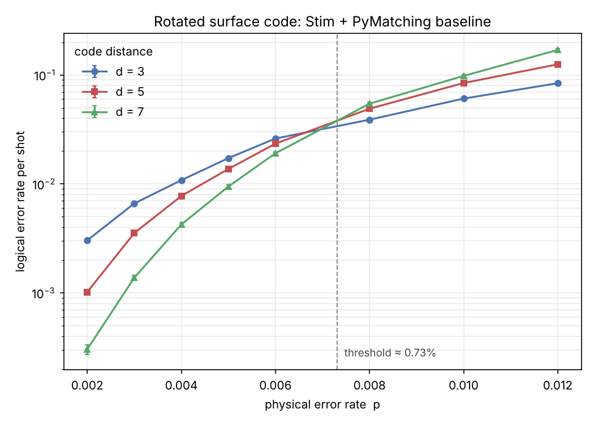
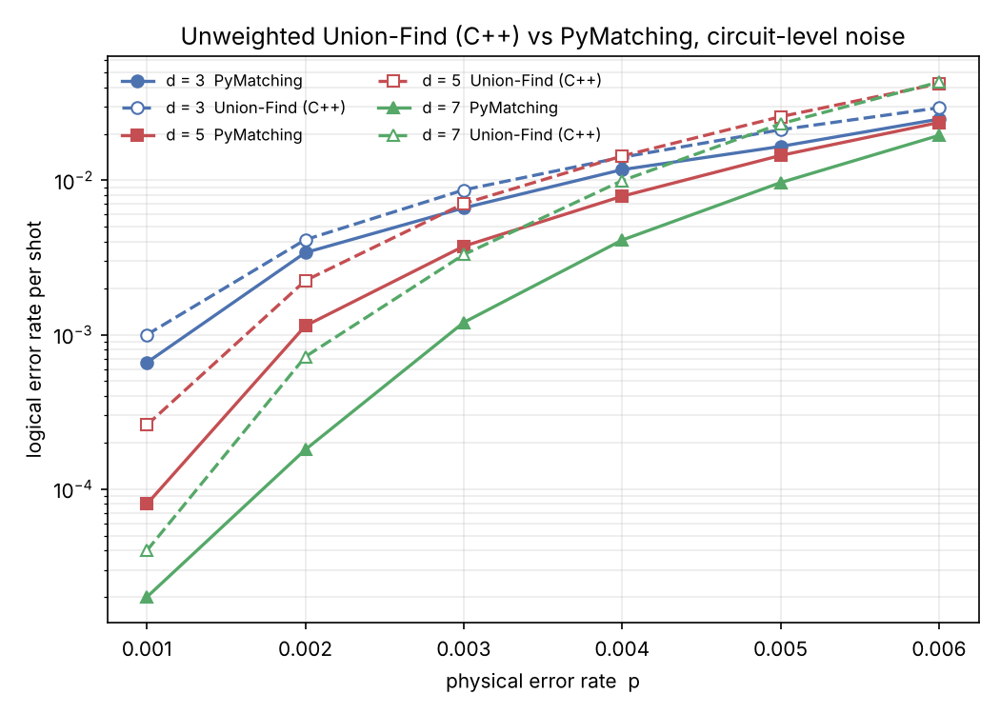

# backlog

**Un décodeur de correction d'erreurs quantiques temps réel, bâti de zéro :
de la simulation jusqu'au FPGA.**

[English version](README.md)



## Pourquoi « backlog »

Un ordinateur quantique tolérant aux fautes doit décoder les erreurs plus vite
qu'elles apparaissent. Si le décodeur est plus lent que le flux de syndromes,
le retard s'accumule et le calcul ralentit de façon exponentielle. Sur une
puce supraconductrice, un cycle de correction dure environ 1 microseconde :
le décodeur a donc un budget temps réel strict. Ce projet construit un
décodeur pour ce problème et le mesure honnêtement à chaque étape.

## État

| phase | contenu | état |
|---|---|---|
| 1 | Baseline Stim + PyMatching, balayage du seuil | fait |
| 2 | Décodeur Union-Find en C++, comparé à PyMatching | v0 faite |
| 3 | Décodeur Union-Find en VHDL, vérifié, synthétisé, placé-routé | 1D fait |
| 4 | Démo web, article, contribution upstream | à venir |

Détails et prochaines étapes : [docs/roadmap.md](docs/roadmap.md).

## Résultats clés

Tous les chiffres se reproduisent à partir de ce dépôt.

- **Baseline.** Surface code rotatif, bruit au niveau circuit, d = 3, 5, 7
  avec PyMatching : seuil d'environ **0,73 %** (graphe ci-dessus,
  `make baseline`).
- **Union-Find en C++.** Chaque correction reproduit son syndrome (100 % sur
  le code de répétition et le surface code d = 3, 5, 7). Il supprime encore
  les erreurs quand la distance augmente sous son propre seuil, autour de
  0,5 à 0,6 %, plus bas que PyMatching parce que la croissance n'est pas
  pondérée. La croissance pondérée est la prochaine étape.
  [Détails](cpp/README.md).
- **VHDL.** Identique au modèle de référence, bit pour bit, sur plus de
  6 000 vecteurs (N = 8, 16, 32). Après placement-routage sur un iCE40 HX8K :
  94,5 MHz à N = 8, soit environ 10,6 ns par ronde de croissance. Le Fmax
  baisse avec N et la cause est identifiée : des chaînes de XOR en cascade,
  qu'un scan préfixe parallèle peut corriger. [Détails](hardware/README.md).



## Démarrage rapide

```bash
pip install -r requirements.txt     # stim, pymatching, sinter, numpy, matplotlib
make quick       # test rapide du pipeline de seuil (quelques secondes)
make test        # compile le décodeur C++ et roule ses tests
make hw-sim      # simulation VHDL bit pour bit (requiert ghdl)
make baseline    # balayage complet du seuil (quelques minutes), puis : make plot
make bench       # Union-Find C++ contre PyMatching sur le surface code
make hw          # synthèse VHDL + placement-routage (requiert yosys, nextpnr-ice40)
```

## Comment la justesse est vérifiée

Deux questions distinctes, deux vérifications distinctes :

1. **Chaque correction est-elle valide ?** Elle doit reproduire le syndrome
   observé. C'est un invariant strict : le binaire C++ retourne un code
   d'erreur s'il échoue une seule fois, et le testbench VHDL le vérifie sur
   chaque vecteur, indépendamment du modèle de référence.
2. **Est-ce un bon décodeur ?** Taux d'erreur logique contre PyMatching sur
   les mêmes tirages. Les algorithmes diffèrent, donc les résultats aussi :
   l'écart est rapporté, pas caché.

## Limites

- Le décodeur C++ utilise une croissance non pondérée, donc il perd du seuil
  sous un bruit au niveau circuit.
- Le cœur VHDL est en 1D (code de répétition, capacité de code). Ses chiffres
  ne se comparent pas aux décodeurs 2D de surface code comme Helios.
- Pas encore d'exécution sur une vraie carte. Le Fmax vient du
  placement-routage, pas d'une mesure physique.

Les références et la licence (MIT) sont dans la [version anglaise](README.md).
