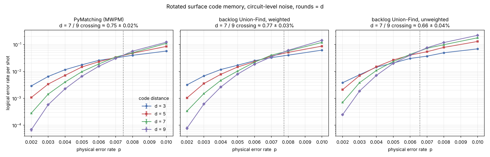
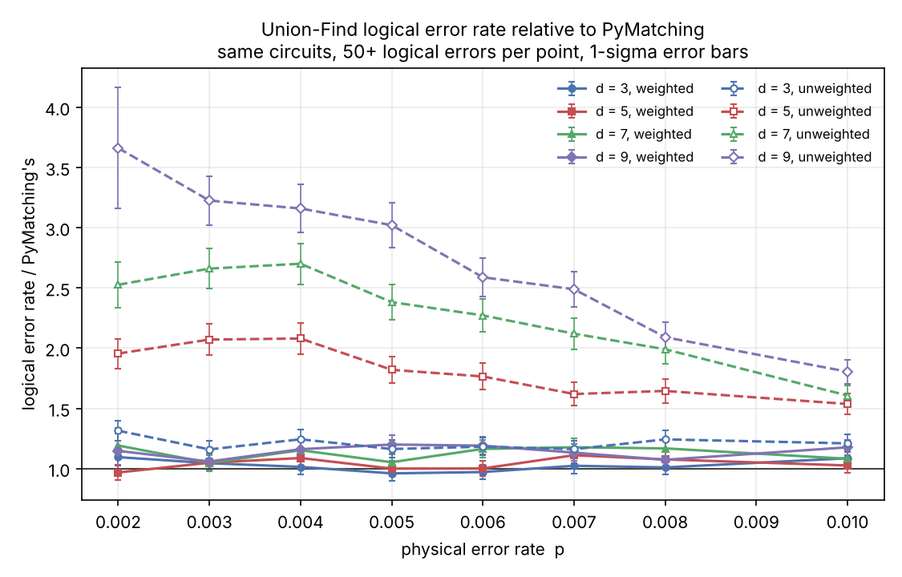
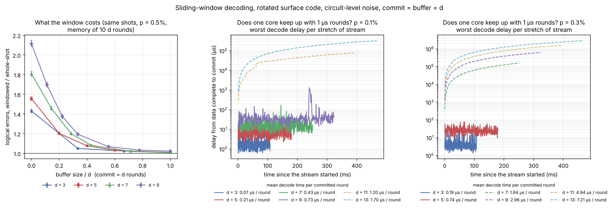
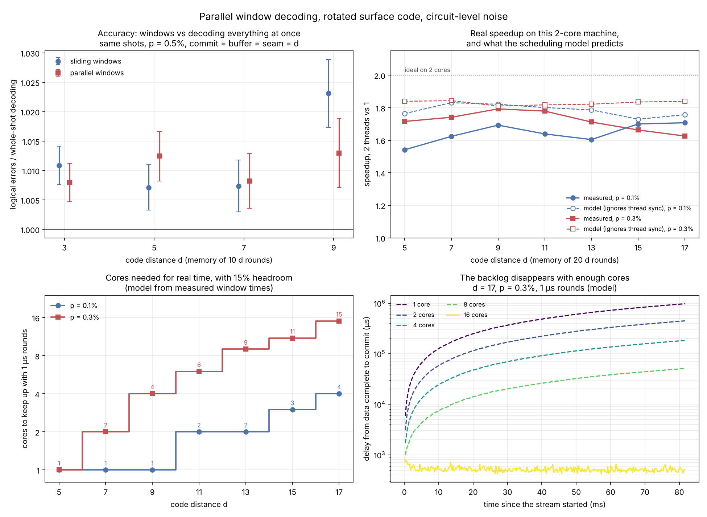
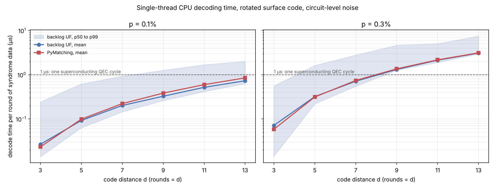

# backlog

**A real-time quantum error correction decoder, built from scratch: from
simulation to FPGA.**

[Version française](README.fr.md)



## Why "backlog"

A fault-tolerant quantum computer has to decode errors faster than they
appear. If the decoder is slower than the stream of syndrome data, the backlog
grows and the computation slows down exponentially. On superconducting chips a
QEC cycle lasts about 1 microsecond, so the decoder has a hard real-time
budget. This project builds a decoder for that problem, measures it honestly
at every step, shows the backlog appearing when one core falls behind, and
makes it disappear with parallel windows.

## Results

Rotated surface code memory, circuit-level noise from Stim. All decoders run
through sinter on the same circuits: 12.8 million shots, 96 data points, at
least 68 logical errors per point. Error bars are one standard deviation.

| | PyMatching 2 (MWPM) | backlog UF, weighted | backlog UF, unweighted |
|---|---|---|---|
| crossing of d = 7 and d = 9 | 0.75 ± 0.02% | 0.77 ± 0.03% | 0.66 ± 0.04% |
| logical error rate vs PyMatching, d = 3 and 5 | 1 | 0.96 to 1.11 | 1.16 to 2.08 |
| logical error rate vs PyMatching, d = 7 and 9 | 1 | 1.05 to 1.20 | 1.61 to 3.66 |
| speed vs PyMatching, d = 3 | 1 | 0.82 to 0.87 | |
| speed vs PyMatching, d = 5 to 13, p = 0.1% | 1 | 1.02 to 1.19 | |
| speed vs PyMatching, d = 5 to 13, p = 0.3% | 1 | 0.98 to 1.04 | |

- **Weighting is what makes Union-Find competitive.** Growing each edge in
  proportion to its log-likelihood brings Union-Find from up to 3.7 times
  PyMatching's logical error rate to within 0 to 20%, with the same threshold
  within error bars.
- **Speed: parity with PyMatching 2, not a blowout.** On one core, this
  decoder is 15 to 19% faster at p = 0.1% from d = 9, level at p = 0.3%, and
  slower at d = 3 (repeat runs agree within about 5%).
- **Streaming works, and scales with cores.** Windows with a buffer of d
  rounds cost at most 2.3% in logical errors. One core keeps up with 1 µs
  rounds to d = 9 at p = 0.1% and to d = 5 at p = 0.3%; past that, the
  backlog grows. Parallel windows split the work over cores: 1.6 to 1.85
  times faster on 2 real cores, and by the measured window times, 4 cores
  keep up to d = 17 at p = 0.1%, 15 cores at p = 0.3%.
- **Same answer as a slow, obviously correct reference.** The fast decoder
  returns the exact same correction as a reference implementation on 75,000
  fuzzed cases, the parallel decoder gives the same answer for any number of
  threads with no data race under ThreadSanitizer, and mutation testing shows
  the tests catch 18 out of 18 injected bugs. How it works:
  [docs/decoder.md](docs/decoder.md).



### Streaming: the backlog, measured



A real-time decoder cannot wait for the end of the experiment.
`SlidingWindowDecoder` decodes `commit + buffer` rounds at a time, keeps the
correction of the oldest `commit` rounds, carries its effect forward and
slides ([how it works](docs/decoder.md#7-sliding-windows-decoding-as-the-rounds-arrive)).

- **Left: a buffer of d rounds is enough.** On the same shots, it gives 0.7
  to 2.3% more logical errors than decoding the whole experiment at once
  (d = 3 to 9, p = 0.5%, 10 d rounds). Without a buffer: 1.4 to 2.1 times
  more.
- **Middle and right: does one core keep up?** Rounds arrive every
  microsecond, and one core decodes the windows in order, each measured in
  C++. Solid lines stay bounded: the decoder keeps up. Dashed lines grow
  without limit: that is the backlog.

| p | keeps up to | work per committed round | first to fall behind |
|---|---|---|---|
| 0.1% | d = 9 | 0.73 µs | d = 11 (1.20 µs) |
| 0.3% | d = 5 | 0.74 µs | d = 7 (1.64 µs) |

Streaming costs about twice the whole-shot work per round, since every round
is decoded once in a buffer and once in a commit region. Keeping up on
average is not the whole story either: at d = 9 and p = 0.1% the core is busy
73% of the time, and a burst of hard windows pushed one delay to 1.3 ms.

### Parallel windows: more cores, no backlog



`ParallelWindowDecoder` decodes core windows (commit d rounds, buffer d on
both sides) all at once, then the seams between them, also all at once
([how it works](docs/decoder.md#8-parallel-windows-more-cores-no-backlog)).

- **Top left: no accuracy lost.** 0.8 to 1.3% more logical errors than
  whole-shot decoding on the same shots, like sliding windows.
- **Top right: real speedup.** 2 threads are 1.6 to 1.85 times faster than
  one on this 2-core machine from d = 7. A scheduling model built from the
  measured time of every window predicts the 2-thread time within 12% from
  d = 9 (it ignores synchronization, so it is a little optimistic).
- **Bottom: how many cores for real time.** The model on a stream of 1 µs
  rounds, with 15% headroom for its optimism:

| d | 9 | 11 | 13 | 15 | 17 |
|---|---|---|---|---|---|
| cores, p = 0.1% | 1 | 2 | 3 | 3 | 4 |
| cores, p = 0.3% | 4 | 6 | 8 | 11 | 15 |

With fewer cores the delay grows without bound (bottom right, d = 17); with
these, it stays under about a millisecond. The cost is latency: a seam's
oldest round waits about 3 d rounds of data before its commit can start.

### Throughput on whole experiments



One thread, Intel Xeon at 2.1 GHz (2-core cloud VM), 20,000 shots per point,
whole memory experiments of d rounds:

| d | p | UF p50 | UF p99 | UF mean | PyMatching mean |
|---|---|---|---|---|---|
| 5 | 0.1% | 0.32 µs | 3.1 µs | 0.46 µs | 0.49 µs |
| 9 | 0.1% | 2.3 µs | 11.4 µs | 2.9 µs | 3.5 µs |
| 13 | 0.1% | 8.2 µs | 26.1 µs | 9.5 µs | 11.0 µs |
| 5 | 0.3% | 1.1 µs | 8.1 µs | 1.6 µs | 1.6 µs |
| 9 | 0.3% | 11.3 µs | 41.9 µs | 11.8 µs | 12.2 µs |
| 13 | 0.3% | 38.4 µs | 97.6 µs | 40.0 µs | 40.7 µs |

### Hardware (v0: 1D, unweighted)

Union-Find core in VHDL, bit-exact against its golden model on 6,000+ vectors
(N = 8, 16, 32). After place and route on an iCE40 HX8K: 94.5 MHz at N = 8,
about 10.6 ns per growth round. Fmax drops with N, and the cause is
identified: ripple XOR chains, fixable with a parallel prefix scan.
[Details](hardware/README.md).

## Use it

```bash
pip install .     # builds the C++ core: needs a C++17 compiler and CMake
```

```python
import stim
import backlog

p = 0.003
circuit = stim.Circuit.generated(
    "surface_code:rotated_memory_z", distance=5, rounds=50,
    after_clifford_depolarization=p, before_round_data_depolarization=p,
    before_measure_flip_probability=p, after_reset_flip_probability=p)
dets, obs = circuit.compile_detector_sampler().sample(20_000, separate_observables=True)

decoder = backlog.UnionFindDecoder.from_circuit(circuit)  # weighted by default
predictions = decoder.decode_batch(dets)
print("logical error rate:", (predictions != obs).any(axis=1).mean())

# Streaming: 5 rounds committed per window, 5 rounds of buffer
window = backlog.SlidingWindowDecoder.from_circuit(circuit, commit=5, buffer=5)
print("windowed:", (window.decode_batch(dets) != obs).any(axis=1).mean())
print(window.windows[:3])  # (first round, end of commit, end of window)

# Parallel windows on 2 threads (same answer for any number of threads)
parallel = backlog.ParallelWindowDecoder.from_circuit(circuit, commit=5, buffer=5, threads=2)
print("parallel:", (parallel.decode_batch(dets) != obs).any(axis=1).mean())
```

As sinter decoders, from Python:

```python
stats = sinter.collect(
    num_workers=4, tasks=tasks, decoders=["backlog-uf", "uf-window"], max_shots=10**6,
    custom_decoders={**backlog.sinter_decoders(),
                     "uf-window": backlog.SinterSlidingWindowDecoder(commit=5, buffer=5)})
```

or from the command line:

```bash
sinter collect --circuits circuit.stim --decoders backlog-uf pymatching \
    --custom_decoders_module_function "backlog:sinter_decoders" \
    --max_shots 100000 --processes 4 --save_resume_filepath stats.csv
```

`backlog-uf-unweighted` is also available, for comparison, and
`backlog.SinterParallelWindowDecoder(commit=5, buffer=5)` for parallel windows.

## Reproduce

```bash
pip install -r requirements.txt && make install   # in a virtualenv
make test        # C++ tests and fuzzing, pytest, command-line checks
make mutants     # mutation testing, about seven minutes
make tsan        # C++ tests under ThreadSanitizer
make compare     # PyMatching vs Union-Find sweep with sinter (long, resumable)
make streaming   # sliding windows: accuracy, latency, backlog (a few minutes)
make parallel    # parallel windows: accuracy, speedup, cores needed (a few minutes)
make latency     # whole-shot decoding time, on an idle machine
make hw-sim      # VHDL simulation, bit-exact (needs ghdl)
make hw          # VHDL synthesis, place and route (needs yosys, nextpnr-ice40)
make help        # everything else
```

## How correctness is checked

1. **Every correction is valid.** It must reproduce the observed syndrome.
   This is checked on every decode in every test, and the command-line
   decoder exits non-zero if it fails once.
2. **Fast equals reference.** `ReferenceDecoder` is a short, synchronous,
   obviously correct version of the algorithm. The fast event-driven decoder
   must return the same correction, edge for edge: 75,000 fuzzed cases on
   random graphs (parallel edges included), plus real surface code models.
3. **Windows are checked the same way.** On 75,000 fuzzed layered graphs for
   each window decoder, with random window sizes, the committed corrections
   always reproduce the syndrome, and one window covering every round gives
   exactly the whole-shot answer. The parallel decoder must give the same
   correction with 1 and 3 threads, and the suite runs clean under
   ThreadSanitizer. Unit tests pin down errors cut by a window edge.
4. **The tests catch bugs.** `make mutants` injects 18 realistic bugs one at
   a time (wrong growth rate, lost radius on merge, forest ignoring weights,
   window flips not carried forward, seams ignoring the cores' flips...) and
   requires the suite to fail on each.
5. **Accuracy is gated.** pytest fails if weighted Union-Find exceeds 1.35
   times PyMatching's logical error rate at d = 5, p = 0.5%, or if a buffer of
   d rounds costs more than 5% over whole-shot decoding; the command-line
   checks gate at 1.5 times PyMatching on four codes.
6. **Hardware.** The VHDL testbench compares every output to the golden model
   bit for bit, and checks the syndrome invariant independently.

All of it runs in CI on every push.

## Layout

```
src/backlog/   Python package: error model conversion, decoders, sinter plugin
cpp/           C++17 core (no dependencies): fast, reference, sliding-window and
               parallel-window decoders, tests, CLI, bindings
tests/         pytest: accuracy gates, windows, sinter integration
python/        experiments: circuits, sweeps, benchmarks, figures
hardware/      VHDL 1D core: golden model, RTL, testbench, synthesis, place and route
scripts/       command-line checks, mutation testing
results/       data and figures produced by the scripts
docs/          how the decoder works, roadmap
```

## Limitations

- **Models beyond 2 cores.** This machine has 2 cores. The core counts above
  come from a scheduling model built on measured window times, checked
  against the real 2-thread run only; a big machine adds memory and cache
  contention the model does not see. The stream replays chain windows
  measured on independent shots, an approximation of one long experiment.
- **Speed parity, not a win.** At p = 0.3% this decoder only matches
  PyMatching 2 on one core.
- **Accuracy.** Weighted Union-Find still makes 5 to 20% more logical errors
  than matching at d = 7 and 9.
- **Shared machine.** Timings come from a 2-core cloud VM. Repeat runs agree
  within about 5%, but absolute times will differ on your machine.
- **Scope.** Graphlike error models only (Stim decomposes hyperedges), up to
  64 logical observables, memory experiments (no lattice surgery yet).
- **Hardware is v0.** The VHDL core is 1D, unweighted, code capacity. Its
  numbers are not comparable to 2D surface code decoders like Helios, and
  there is no board run yet: Fmax comes from place and route.

## Roadmap

Done: Stim + PyMatching baseline, weighted event-driven Union-Find with
sinter integration, sliding-window streaming with the backlog measured,
parallel windows that remove it given enough cores, 1D VHDL core. Next: a
parallel prefix scan in the VHDL core, then a 2D surface code core, so one
small FPGA can do the work of many CPU cores. Details in
[docs/roadmap.md](docs/roadmap.md).

## References

- C. Gidney, *Stim: a fast stabilizer circuit simulator*, Quantum 5, 497 (2021)
- O. Higgott and C. Gidney, *Sparse Blossom: correcting a million errors per
  core second with minimum-weight matching*, Quantum 9, 1600 (2025)
- N. Delfosse and N. H. Nickerson, *Almost-linear time decoding algorithm for
  topological codes*, Quantum 5, 595 (2021)
- N. Delfosse and G. Zemor, *Linear-time maximum likelihood decoding of
  surface codes over the quantum erasure channel*, Phys. Rev. Research 2,
  033042 (2020)
- S. Huang, M. Newman and K. R. Brown, *Fault-tolerant weighted union-find
  decoding on the toric code*, Phys. Rev. A 102, 012419 (2020)
- L. Skoric, D. E. Browne, K. M. Barnes, N. I. Gillespie and E. T. Campbell,
  *Parallel window decoding enables scalable fault tolerant quantum
  computation*, Nat. Commun. 14, 7040 (2023)
- X. Tan, F. Zhang, R. Chao, Y. Shi and J. Chen, *Scalable surface-code
  decoders with parallelization in time*, PRX Quantum 4, 040344 (2023)
- N. Liyanage, Y. Wu, S. Tagare and L. Zhong, *FPGA-based distributed
  Union-Find decoder for surface codes*, IEEE TQE (2024)
- B. M. Terhal, *Quantum error correction for quantum memories*, Rev. Mod.
  Phys. 87, 307 (2015)

## License

MIT
