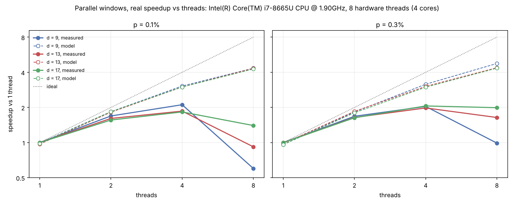

# backlog

[](https://github.com/jcedrik/backlog/actions/workflows/ci.yml)
[](pyproject.toml)
[](LICENSE)
[](#effective-distance-every-pair-of-faults-decoded)

**A real-time quantum error correction decoder, built from scratch: from
simulation to FPGA.**

Weighted Union-Find for the surface code, as fast as PyMatching on one core;
correlated decoding within a few percent of PyMatching's correlated matching,
and faster at large distance; streaming and parallel window decoders; Stim
and sinter integration; a VHDL core checked bit for bit against the C++.

[Version française](README.fr.md) · [Quickstart notebook](examples/quickstart.ipynb) ·
[How it works](docs/decoder.md) · [State of the art](docs/related-work.md)

```bash
pip install git+https://github.com/jcedrik/backlog   # builds the C++ core: C++17 compiler and CMake
```

```python
import backlog, stim

circuit = stim.Circuit.generated("surface_code:rotated_memory_z", distance=5, rounds=5,
                                 after_clifford_depolarization=0.003)
dets, obs = circuit.compile_detector_sampler().sample(100_000, separate_observables=True)

decoder = backlog.UnionFindDecoder.from_circuit(circuit, correlated=True)
print("logical error rate:", (decoder.decode_batch(dets) != obs).any(axis=1).mean())
```

## New in v0.5

- **Correlated Union-Find.** Two passes, as PyMatching's
  `enable_correlations`: the edges of the first correction make their
  partners in decomposed errors (the X and Z halves of a Y error) cheaper,
  then the decoder runs again. On the same shots, it makes 7 to 12% fewer
  logical errors than plain Union-Find at d = 3, 21 to 38% fewer at d = 5,
  32 to 67% fewer at d = 7, and fewer than plain PyMatching everywhere. The
  error suppression factor Λ goes from 3.3 to 5.2 at p = 0.3%.
- **A result from October 2026, reproduced on a Union-Find decoder.**
  Standard correlated decoding loses a unit of distance deep below threshold
  ([Hernando de la Fuente et al., arXiv:2610.26785](https://arxiv.org/abs/2610.26785),
  Leiden and Riverlane). Decoding all 1.9 million pairs of faults of the
  d = 5 circuit: plain Union-Find and PyMatching get none wrong; correlated
  Union-Find gets 284 to 425 wrong, PyMatching's correlated matching 281 to
  440; the paper's regularized rule brings that to zero.
- **A practical finding: the decomposition matters.** With Stim's own
  decomposition, correlated decoding at d = 3 and p = 0.1% makes 44% *more*
  logical errors than plain decoding, for PyMatching and backlog alike.
  Splitting every error into exactly its X part and its Z part
  (`backlog.decompose_by_basis`, now the default) turns that into a gain and
  takes the gain at d = 5 from 28% to 46%.
- **Parallel windows without a barrier.** A seam starts as soon as its two
  cores have committed, idle threads pause instead of hammering a
  hyperthread, and `make scaling` now splits the speedup into work inflation
  and idle time.
- **Easy to pick up.** A [quickstart notebook](examples/quickstart.ipynb),
  wheels for Linux, macOS and Windows built in CI for the first PyPI release,
  [contributing notes](CONTRIBUTING.md) and a [citation file](CITATION.cff).


## Why "backlog"

A fault-tolerant quantum computer has to decode errors faster than they
appear. If the decoder is slower than the stream of syndrome data, the backlog
grows and the computation slows down exponentially. On superconducting chips a
QEC cycle lasts about 1 microsecond, so the decoder has a hard real-time
budget. This project builds a decoder for that problem, measures it honestly
at every step, shows the backlog appearing when one core falls behind, and
makes it disappear with parallel windows. Where it stands among published
decoders (Google, Riverlane, Micro Blossom, Helios, NVIDIA, AlphaQubit 2):
[docs/related-work.md](docs/related-work.md).

## Results

All experiments: rotated surface code memories from Stim, d rounds unless
stated, every noise channel at p (uniform circuit-level noise). Error bars are
one standard deviation.

### Accuracy and speed against PyMatching

Through sinter on the same circuits: 12.8 million shots, 96 data points, at
least 68 logical errors per point.

| | PyMatching 2 (MWPM) | backlog UF, weighted | backlog UF, unweighted |
|---|---|---|---|
| crossing of d = 7 and d = 9 | 0.75 ± 0.02% | 0.77 ± 0.03% | 0.66 ± 0.04% |
| logical error rate vs PyMatching, d = 3 and 5 | 1 | 0.96 to 1.11 | 1.16 to 2.08 |
| logical error rate vs PyMatching, d = 7 and 9 | 1 | 1.05 to 1.20 | 1.61 to 3.66 |
| speed vs PyMatching, d = 3 | 1 | 0.82 to 0.87 | |
| speed vs PyMatching, d = 5 to 13, p = 0.1% | 1 | 1.02 to 1.19 | |
| speed vs PyMatching, d = 5 to 13, p = 0.3% | 1 | 0.98 to 1.04 | |

- **Weighting is what makes Union-Find competitive.** Growing each edge in
  proportion to its log-likelihood brings Union-Find from up to 3.7 times
  PyMatching's logical error rate to within 0 to 20%, with the same threshold
  within error bars.
- **Speed: parity with PyMatching 2, not a blowout.** On one core, this
  decoder is 15 to 19% faster at p = 0.1% from d = 9, level at p = 0.3%, and
  slower at d = 3 (repeat runs agree within about 5%).


### Correlated decoding

Every decoder sees the same shots (up to 6 million per point, at least 32
logical errors for every decoder), so the ratios carry paired error bars.
Logical errors of correlated Union-Find divided by those of plain Union-Find:

| | p = 0.1% | 0.2% | 0.3% | 0.5% | 0.7% |
|---|---|---|---|---|---|
| d = 3 | 0.88 ± 0.03 | 0.89 ± 0.03 | 0.93 ± 0.03 | 0.89 ± 0.02 | 0.93 ± 0.01 |
| d = 5 | 0.64 ± 0.04 | 0.62 ± 0.03 | 0.68 ± 0.03 | 0.72 ± 0.03 | 0.79 ± 0.02 |
| d = 7 | 0.33 ± 0.05 | 0.36 ± 0.03 | 0.44 ± 0.03 | 0.60 ± 0.03 | 0.68 ± 0.02 |

PyMatching's correlated matching gains about the same against plain
PyMatching. Correlated Union-Find ends 1 to 22% above correlated PyMatching
(6% at the median point), about the same gap as between the plain decoders. Error suppression, Λ = logical error per round at d = 5 / at d = 7:

| p | Union-Find | correlated UF | PyMatching | correlated PyMatching |
|---|---|---|---|---|
| 0.1% | 9.9 | 19 | 10.1 | 22 |
| 0.2% | 5.1 | 8.7 | 6.0 | 8.5 |
| 0.3% | 3.3 | 5.2 | 3.5 | 5.3 |
| 0.5% | 1.8 | 2.2 | 1.9 | 2.4 |

(At p = 0.1%, the d = 7 points rest on 32 to 119 logical errors, so those Λ
are good to 10 to 20%.) Correlated decoding costs about 3 times the time of
one pass, for both decoders; correlated Union-Find is within 10% of
correlated PyMatching at d = 5 and 9 and faster from d = 13 (4.2 against
5.8 µs per round at d = 17, p = 0.1%). [How it works](docs/decoder.md#9-correlated-decoding).

### Effective distance: every pair of faults, decoded

A distance-d code must correct every set of (d-1)/2 faults. Hernando de la
Fuente et al. found that standard correlated decoding does not: a first-pass
edge can discount several partner edges at once, as if their joint
occurrence were free. `make faults` checks it exhaustively, on every pair of
faults of the d = 5 circuit (1,906,128 pairs):

| d = 5, pairs decoded wrongly | p = 10⁻⁴ | 3·10⁻⁴ | 10⁻³ | 3·10⁻³ |
|---|---|---|---|---|
| Union-Find, PyMatching | 0 | 0 | 0 | 0 |
| correlated Union-Find, α = 1 | 425 | 367 | 320 | 284 |
| correlated PyMatching | 440 | 361 | 311 | 281 |
| correlated Union-Find, α = 0.1 | 11 | 4 | 2 | 2 |
| correlated Union-Find, α = 0.05 | 2 | 0 | 0 | 0 |


The regularized rule multiplies every conditional probability by α ≤ 1. A
small α restores the distance but gives up some of the real correlation, so
the best α depends on p: the Monte Carlo runs and the exact d = 3 enumeration
both follow the paper's form α*(p) = 1 / (1 + 10⁻³/p)
(`backlog.regularization_strength(p)`): about 0.5 at p = 0.1%, falling toward
0.1 at 10⁻⁴, where the lost distance would dominate.

### Streaming: the backlog, measured


A real-time decoder cannot wait for the end of the experiment.
`SlidingWindowDecoder` decodes `commit + buffer` rounds at a time, keeps the
correction of the oldest `commit` rounds, carries its effect forward and
slides ([how it works](docs/decoder.md#7-sliding-windows-decoding-as-the-rounds-arrive)).

- **Left: a buffer of d rounds is enough.** On the same shots, it gives 0.7
  to 2.3% more logical errors than decoding the whole experiment at once
  (d = 3 to 9, p = 0.5%, 10 d rounds). Without a buffer: 1.4 to 2.1 times
  more.
- **Middle and right: does one core keep up?** Rounds arrive every
  microsecond, and one core decodes the windows in order, each measured in
  C++. Solid lines stay bounded: the decoder keeps up. Dashed lines grow
  without limit: that is the backlog.

| p | keeps up to | work per committed round | first to fall behind |
|---|---|---|---|
| 0.1% | d = 9 | 0.73 µs | d = 11 (1.20 µs) |
| 0.3% | d = 5 | 0.74 µs | d = 7 (1.64 µs) |

Streaming costs about twice the whole-shot work per round, since every round
is decoded once in a buffer and once in a commit region. Keeping up on
average is not the whole story either: at d = 9 and p = 0.1% the core is busy
73% of the time, and a burst of hard windows pushed one delay to 1.3 ms.

### Parallel windows: more cores, no backlog


`ParallelWindowDecoder` decodes core windows (commit d rounds, buffer d on
both sides) in parallel, and each seam between two cores as soon as both
have committed ([how it works](docs/decoder.md#8-parallel-windows-more-cores-no-backlog)).

- **Top left: no accuracy lost.** 0.8 to 1.3% more logical errors than
  whole-shot decoding on the same shots, like sliding windows.
- **Top right: real speedup.** 2 threads are 1.54 to 1.79 times faster than
  one on this 2-core machine (d = 5 to 17). A scheduling model built from the
  measured time of every window predicts the 2-thread time within 1 to 13%
  (it ignores synchronization, so it is a little optimistic).
- **Bottom: how many cores for real time.** The model on a stream of 1 µs
  rounds, with 15% headroom for its optimism:

| d | 9 | 11 | 13 | 15 | 17 |
|---|---|---|---|---|---|
| cores, p = 0.1% | 1 | 2 | 2 | 3 | 4 |
| cores, p = 0.3% | 4 | 6 | 9 | 11 | 15 |

With fewer cores the delay grows without bound (bottom right, d = 17); with
these, it stays under about a millisecond. The cost is latency: a seam's
oldest round waits about 3 d rounds of data before its commit can start.

**Measured on a real 4-core laptop** (Intel i7-8665U, 15 W, Ubuntu on WSL2,
v0.4 scheduler), the model falls apart past 2 threads:



The model was 9 to 18% optimistic at 2 threads, 45 to 63% at 4, and wrong at
8, where decoding got slower (0.6x at d = 9). It assumes every core decodes a
window as fast as one core alone, while the turbo frequency of a 15 W chip
drops as more cores wake up, the cores share one cache, and idle workers were
spinning on the hyperthreads of busy cores. v0.5 removes the barrier between
cores and seams and stops spinning on hyperthreads; `make scaling` now
reports, for every thread count, the work inflation and the share of time
threads wait, to tell the machine's limits from the scheduler's.

### Throughput on whole experiments


One thread, Intel Xeon at 2.1 GHz (2-core cloud VM), 20,000 shots per point,
whole memory experiments of d rounds:

| d | p | UF p50 | UF p99 | UF mean | PyMatching mean |
|---|---|---|---|---|---|
| 5 | 0.1% | 0.32 µs | 3.1 µs | 0.46 µs | 0.49 µs |
| 9 | 0.1% | 2.3 µs | 11.4 µs | 2.9 µs | 3.5 µs |
| 13 | 0.1% | 8.2 µs | 26.1 µs | 9.5 µs | 11.0 µs |
| 5 | 0.3% | 1.1 µs | 8.1 µs | 1.6 µs | 1.6 µs |
| 9 | 0.3% | 11.3 µs | 41.9 µs | 11.8 µs | 12.2 µs |
| 13 | 0.3% | 38.4 µs | 97.6 µs | 40.0 µs | 40.7 µs |

### Hardware (v0: 1D, unweighted)

Union-Find core in VHDL, bit-exact against its golden model on 6,000+ vectors
(N = 8, 16, 32). After place and route on an iCE40 HX8K: 94.5 MHz at N = 8,
about 10.6 ns per growth round. Fmax drops with N, and the cause is
identified: ripple XOR chains, fixable with a parallel prefix scan.
[Details](hardware/README.md).

## Use it

```bash
pip install git+https://github.com/jcedrik/backlog   # or, from a clone: make install
```

```python
import stim
import backlog

p = 0.003
circuit = stim.Circuit.generated(
    "surface_code:rotated_memory_z", distance=5, rounds=50,
    after_clifford_depolarization=p, before_round_data_depolarization=p,
    before_measure_flip_probability=p, after_reset_flip_probability=p)
dets, obs = circuit.compile_detector_sampler().sample(20_000, separate_observables=True)

decoder = backlog.UnionFindDecoder.from_circuit(circuit)  # weighted by default
print("plain:", (decoder.decode_batch(dets) != obs).any(axis=1).mean())

# Correlated (two passes); alpha < 1 is the regularized rule of arXiv:2610.26785
corr = backlog.UnionFindDecoder.from_circuit(
    circuit, correlated=True, alpha=backlog.regularization_strength(p))
print("correlated:", (corr.decode_batch(dets) != obs).any(axis=1).mean())

# Streaming: 5 rounds committed per window, 5 rounds of buffer
window = backlog.SlidingWindowDecoder.from_circuit(circuit, commit=5, buffer=5, correlated=True)
print("windowed:", (window.decode_batch(dets) != obs).any(axis=1).mean())

# Parallel windows on 2 threads (same answer for any number of threads)
parallel = backlog.ParallelWindowDecoder.from_circuit(circuit, commit=5, buffer=5, threads=2)
print("parallel:", (parallel.decode_batch(dets) != obs).any(axis=1).mean())
```

As sinter decoders (`backlog-uf`, `backlog-uf-corr`, `backlog-uf-unweighted`),
from Python:

```python
stats = sinter.collect(
    num_workers=4, tasks=tasks, decoders=["backlog-uf-corr", "uf-window"], max_shots=10**6,
    custom_decoders={**backlog.sinter_decoders(),
                     "uf-window": backlog.SinterSlidingWindowDecoder(commit=5, buffer=5)})
```

or from the command line:

```bash
sinter collect --circuits circuit.stim --decoders backlog-uf-corr pymatching \
    --custom_decoders_module_function "backlog:sinter_decoders" \
    --max_shots 100000 --processes 4 --save_resume_filepath stats.csv
```

Using PyMatching's correlated matching on a Stim circuit? Decompose the
model with `backlog.decompose_by_basis(dem)` rather than Stim's
`decompose_errors=True`: that is the decomposition that makes correlations
pay (see above).

## Reproduce

```bash
pip install -r requirements.txt && make install   # in a virtualenv
make test        # C++ tests and fuzzing, pytest, command-line checks
make mutants     # mutation testing, about ten minutes
make tsan        # C++ tests under ThreadSanitizer
make faults      # every pair of faults at d = 3 and 5, every decoder (~6 min)
make correlated  # correlated vs plain vs PyMatching, same shots (~15 min on 2 cores)
make compare     # PyMatching vs Union-Find sweep with sinter (long, resumable)
make streaming   # sliding windows: accuracy, latency, backlog (a few minutes)
make parallel    # parallel windows: accuracy, speedup, cores needed (a few minutes)
make scaling     # speedup, work inflation and idle time with 1, 2, 4, ... threads
make latency     # whole-shot decoding time, on an idle machine
make hw-sim      # VHDL simulation, bit-exact (needs ghdl)
make hw          # VHDL synthesis, place and route (needs yosys, nextpnr-ice40)
make help        # everything else
```

## How correctness is checked

1. **Every correction is valid.** It must reproduce the observed syndrome.
   This is checked on every decode in every test, and the command-line
   decoder exits non-zero if it fails once.
2. **Fast equals reference.** `ReferenceDecoder` is a short, synchronous,
   obviously correct version of the algorithm. The fast event-driven decoder
   must return the same correction, edge for edge: 75,000 fuzzed cases on
   random graphs (parallel edges included), plus real surface code models.
3. **Correlated decoding is the decoder on the reweighted graph.** On 75,000
   fuzzed cases with random reweighting rules, the second pass must equal the
   reference decoder run on the explicitly reweighted graph, edge for edge,
   with one decoder reused across shots (so weights and adjacency must come
   back after every shot).
4. **Windows are checked the same way.** On 75,000 fuzzed layered graphs for
   each window decoder, half of them correlated, the committed corrections
   always reproduce the syndrome, and one window covering every round gives
   exactly the whole-shot answer. The parallel decoder must give the same
   correction with 1 and 3 threads, and the suite runs clean under
   ThreadSanitizer.
5. **The tests catch bugs.** `make mutants` injects 26 realistic bugs one at
   a time (wrong growth rate, lost radius on merge, flips not carried
   forward, a seam started before both its cores, weights not restored after
   a correlated shot, a lowered edge left out of place in the sorted
   adjacency...) and requires the suite to fail on each. It does, 26 out of 26.
6. **Accuracy and distance are gated.** pytest fails if weighted Union-Find
   exceeds 1.35 times PyMatching's logical error rate at d = 5, p = 0.5%, if
   correlated decoding does not remove at least 15% of the errors at d = 5 or
   strays more than 15% from correlated PyMatching, if a buffer of d rounds
   costs more than 5%, or if, among all 1.9 million pairs of faults at d = 5,
   plain Union-Find or the regularized rule gets a single one wrong.
7. **Hardware.** The VHDL testbench compares every output to the golden model
   bit for bit, and checks the syndrome invariant independently.

All of it runs in CI on every push.

## Layout

```
src/backlog/   Python package: error model conversion, correlations, decoders, sinter plugin
cpp/           C++17 core (no dependencies): fast, reference, correlated, sliding-window and
               parallel-window decoders, tests, CLI, bindings
tests/         pytest: accuracy gates, correlated decoding, windows, sinter integration
python/        experiments: sweeps, benchmarks, fault enumeration, figures
examples/      quickstart notebook
hardware/      VHDL 1D core: golden model, RTL, testbench, synthesis, place and route
scripts/       command-line checks, mutation testing
results/       data and figures produced by the scripts
docs/          how the decoder works, related work, roadmap
```

## Limitations

- **Scaling measured on a laptop only.** On a 4-core laptop the v0.4 decoder
  topped out around 2x at 4 threads, and the core counts above are lower
  bounds until `make scaling` runs on a server with pinned cores. The stream
  replays chain windows measured on independent shots, an approximation of
  one long experiment.
- **One noise model.** Every number here is for uniform circuit-level noise;
  the regularization constants in particular should be refitted for another
  model (SI1000, hardware-derived).
- **α is a parameter.** The decoder does not know the physical error rate;
  `regularization_strength(p)` gives the value these benchmarks support.
- **Accuracy.** Union-Find, plain or correlated, still makes 1 to 22% more
  logical errors than the matching decoder of the same kind.
- **Shared machine.** Timings come from a 2-core cloud VM. Repeat runs agree
  within about 5%, but absolute times will differ on your machine.
- **Scope.** Graphlike error models only (Stim decomposes hyperedges), up to
  64 logical observables, memory experiments (no lattice surgery yet).
- **Hardware is v0.** The VHDL core is 1D, unweighted, code capacity. Its
  numbers are not comparable to 2D surface code decoders like Helios, and
  there is no board run yet: Fmax comes from place and route.

## Roadmap

Done: Stim + PyMatching baseline, weighted event-driven Union-Find with
sinter integration, sliding-window streaming with the backlog measured,
parallel windows, correlated decoding with the regularized rule and an exact
check of the effective distance. Next: measure the new scheduler on a machine
with many physical cores, correlated decoding at d = 7 and beyond by
enumerating triples of faults, then a 2D surface code core in VHDL, so one
small FPGA can do the work of many CPU cores. Details in
[docs/roadmap.md](docs/roadmap.md).

## Citing

If backlog helps your work, cite it with [CITATION.cff](CITATION.cff) (GitHub's
"Cite this repository" button), and the papers below that it builds on.

## References

- C. Gidney, *Stim: a fast stabilizer circuit simulator*, Quantum 5, 497 (2021)
- O. Higgott and C. Gidney, *Sparse Blossom: correcting a million errors per
  core second with minimum-weight matching*, Quantum 9, 1600 (2025)
- N. Delfosse and N. H. Nickerson, *Almost-linear time decoding algorithm for
  topological codes*, Quantum 5, 595 (2021)
- N. Delfosse and G. Zemor, *Linear-time maximum likelihood decoding of
  surface codes over the quantum erasure channel*, Phys. Rev. Research 2,
  033042 (2020)
- S. Huang, M. Newman and K. R. Brown, *Fault-tolerant weighted union-find
  decoding on the toric code*, Phys. Rev. A 102, 012419 (2020)
- A. G. Fowler, *Optimal complexity correction of correlated errors in the
  surface code*, arXiv:1310.0863 (2013)
- C. Hernando de la Fuente, J. Majaniemi, E. van Nieuwenburg and F. Frohnert,
  *Correlated decoding loses the surface code's effective distance below
  threshold*, arXiv:2610.26785 (2026)
- L. Skoric, D. E. Browne, K. M. Barnes, N. I. Gillespie and E. T. Campbell,
  *Parallel window decoding enables scalable fault tolerant quantum
  computation*, Nat. Commun. 14, 7040 (2023)
- X. Tan, F. Zhang, R. Chao, Y. Shi and J. Chen, *Scalable surface-code
  decoders with parallelization in time*, PRX Quantum 4, 040344 (2023)
- N. Liyanage, Y. Wu, S. Tagare and L. Zhong, *FPGA-based distributed
  Union-Find decoder for surface codes*, IEEE TQE (2024)
- B. M. Terhal, *Quantum error correction for quantum memories*, Rev. Mod.
  Phys. 87, 307 (2015)

## License

MIT
