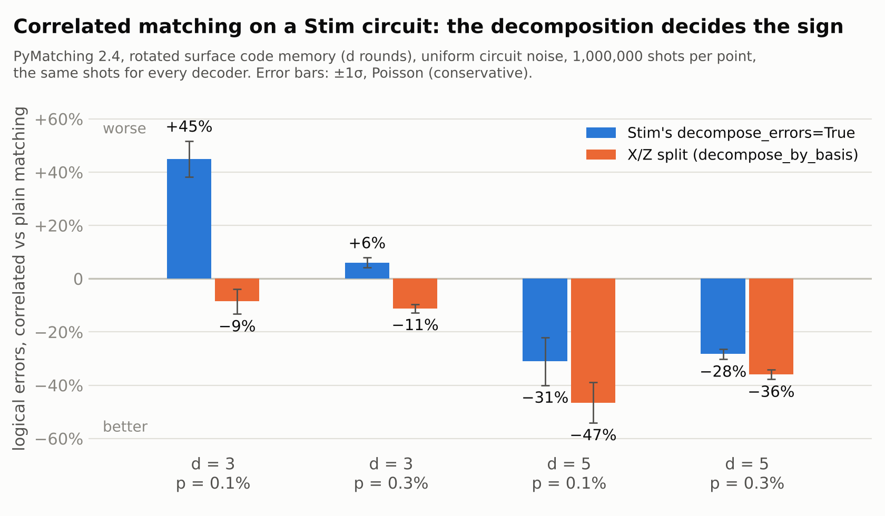
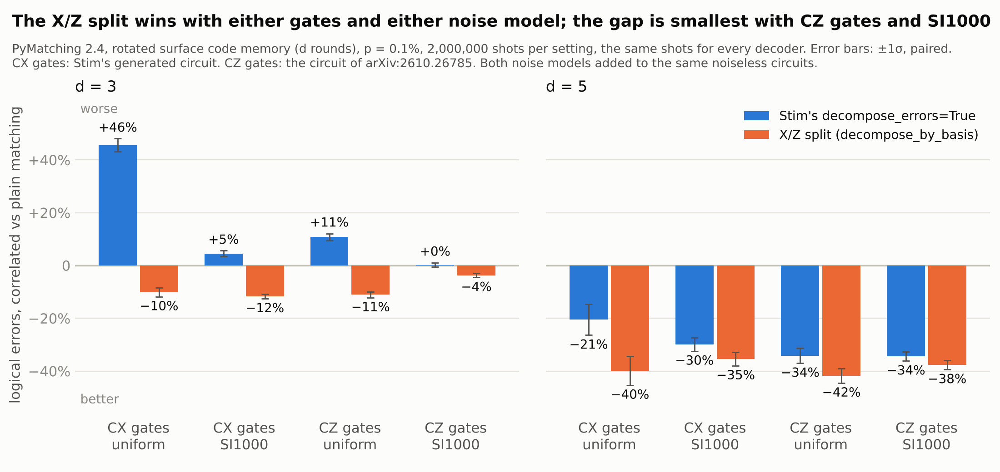

# Correlated decoding made my surface code worse: Stim's decomposition was the cause

Jean-Cédrik Dorélas · November 2026

On Stim's rotated surface code with uniform circuit noise, at d = 3 and
p = 0.1%, correlated matching made 45% more logical errors than plain
matching, and the cause was the decomposition of the error model, not the
decoder. I hit this while adding correlated decoding to
[backlog](https://github.com/jcedrik/backlog), my open-source Union-Find
decoder, and PyMatching's correlated matching does exactly the same thing on
the same model (1,161 against 801 errors per million shots). Splitting every
error into its X part and its Z part, instead of using Stim's
`decompose_errors=True`, turns that loss into a 9% gain, and at d = 5 it takes
the gain from 31% to 47%.

## Correlated decoding in two minutes

Matching and Union-Find decoders work on graphs, where every error flips at
most two detectors. A Y error flips detectors of both types, so the model
splits it into an X-type edge and a Z-type edge, and the decoder then treats
them as independent. Correlated decoding gives back what that split threw
away (Fowler, 2013; PyMatching since version 2.3):

1. Decode once.
2. For every edge in that correction, take the edges that came out of the same
   split errors, and lower their weight to match the conditional probability
   that they fired too.
3. Decode again with those weights.

The rules in step 2 come straight from how the model was decomposed. Change
the decomposition and you change which edges get cheaper.

## What goes wrong with Stim's decomposition

Stim's decomposer splits an error into any graphlike pieces that already
occur elsewhere in the model. Most of the time that gives the X part and the
Z part, but not always: on the d = 5 model, about 400 errors come out as
several pieces of the same type.

At d = 3 I decoded every one of the 286 single faults of the circuit. A
distance-3 code must correct all of them, and plain matching does. Correlated
matching gets 6 wrong, and so does my correlated Union-Find. In each case Stim
splits the error into three pieces, two of them halves of the same X-type pair
sent to the boundary: for example `D5 D16 ^ D9 ^ D12`, where D5 and D16 are
Z-type detectors and D9 and D12 are X-type, even though `D9 D12` exists on its
own elsewhere in the model. The rules built from those pieces make boundary
edges cheap that no physical Y error makes likely, and the second pass routes
its correction through the boundary.

## The fix: split every error into its X part and its Z part

In Stim's rotated surface code circuits, a detector's stabilizer type can be
read from its coordinates. So every error can be split into at most two
pieces: its X-type detectors and its Z-type detectors. Each piece keeps the
observables it flips when it occurs on its own elsewhere in the model. This is
also the convention of the coordinate-based decomposition from the Tesseract
decoder, which Hernando de la Fuente et al. use in their correlated matching
code.

backlog ships it as `decompose_by_basis`, and the result plugs straight into
PyMatching:

```python
import stim, pymatching, backlog

p = 1e-3
c = stim.Circuit.generated(
    "surface_code:rotated_memory_z", distance=3, rounds=3,
    after_clifford_depolarization=p, before_measure_flip_probability=p,
    after_reset_flip_probability=p, before_round_data_depolarization=p)

dem_stim = c.detector_error_model(decompose_errors=True)  # Stim's decomposition
dem_xz = backlog.decompose_by_basis(dem_stim)              # X part + Z part

shots, obs = c.compile_detector_sampler(seed=1).sample(300_000, separate_observables=True)
for name, dem in [("Stim decomposition", dem_stim), ("X/Z split", dem_xz)]:
    plain = pymatching.Matching.from_detector_error_model(dem)
    corr = pymatching.Matching.from_detector_error_model(dem, enable_correlations=True)
    e_plain = (plain.decode_batch(shots) != obs).any(axis=1).sum()
    e_corr = (corr.decode_batch(shots, enable_correlations=True) != obs).any(axis=1).sum()
    print(f"{name:18s} plain {e_plain:4d}  correlated {e_corr:4d}  ratio {e_corr / e_plain:.2f}")
```

```
Stim decomposition plain  202  correlated  283  ratio 1.40
X/Z split          plain  206  correlated  189  ratio 0.92
```

That run takes about two seconds with PyMatching 2.4 and Stim 1.16. If you
would rather not depend on backlog, [the PyMatching
issue](https://github.com/oscarhiggott/PyMatching/issues/193) has a standalone
version of the function.

## Results: the decomposition decides the sign

At d = 3, the decomposition flips the result: with Stim's decomposition,
correlated matching is worse than plain matching, and with the X/Z split it is
better. At d = 5 both help, but the split helps clearly more. My correlated
Union-Find follows the same pattern, within 3 points of PyMatching. Every
decoder saw the same million shots per point, and the counts are in
[`results/correlated_decomposition.csv`](../results/correlated_decomposition.csv)
(`make correlated`; the figure: `make decomposition-plot`).



## Noise model or gates?

These runs use Stim's generated circuits: CX gates and uniform circuit noise.
The Leiden and Riverlane paper uses CZ circuits with SI1000 noise, and reports
no significant difference between the two decompositions there (its Appendix
D.1). Two things change between those setups, so I crossed them: Stim's CX
circuit and the paper's CZ circuit, each with uniform noise and with SI1000,
at p = 0.1% (`make noise-study`). The same code adds both noise models to the
noiseless circuits, and it reproduces Stim's own noisy circuit and the paper's
circuit files exactly, error for error.



Both the gates and the noise model shrink the gap, by about as much each, and
the X/Z split still wins in all eight settings:

| Setting | Stim splits differently | X/Z vs Stim, d = 3 | X/Z vs Stim, d = 5 |
|---|---|---|---|
| CX gates, uniform noise (Stim's circuits) | 6.1% | −38% | −26% |
| CX gates, SI1000 | 3.0% | −19% | −10% |
| CZ gates, uniform noise | 4.4% | −21% | −11% |
| CZ gates, SI1000 (the paper's circuits) | 2.7% | −6% | −5% |

The second column is the share of the error probability, at d = 3, carried by
errors that Stim splits into something other than their X and Z parts. The
last two are the logical errors of PyMatching's correlated matching with the
X/Z split, relative to Stim's decomposition, on the same 2 million shots;
correlated Union-Find gives the same picture
([`results/noise_study.csv`](../results/noise_study.csv)).

Which errors Stim mis-splits depends on the circuit, not on the noise
strengths: 88 of the 286 errors of the CX model at d = 3 under both noise
models, 89 of 299 for the CZ model. What changes is how much probability they
carry, and the gap follows that share. SI1000 adds its extra noise on
measurement, reset and idling, whose errors Stim splits correctly or does not
need to split; with CZ gates, the mis-split errors carry less of the
probability too (4.4% instead of 6.1% under uniform noise). In the paper's own
setting the gap is down to 5 to 6%: easy to miss, but still clear with
2 million shots (paired z = −9.9 at d = 3, −3.9 at d = 5).

The exact test agrees. At d = 3, Stim's decomposition makes correlated
matching get 5 or 6 single faults wrong in every setting, and the X/Z split
none, except 2 in the paper's setting. Those 2 go away with the paper's
regularization (α ≤ 0.5 on my Union-Find), so they belong to the distance loss
below, not to the decomposition.

## A separate problem: the distance loss

A clean decomposition does not fix everything. In October, a Leiden and
Riverlane team (Hernando de la Fuente, Majaniemi, van Nieuwenburg and
Frohnert, [arXiv:2610.26785](https://arxiv.org/abs/2610.26785)) showed that
standard correlated decoding loses a unit of effective distance deep below
threshold. One first-pass edge can discount several partner edges at once, as
if their joint occurrence were free.

With the X/Z split in place, I checked it on all 1,906,128 pairs of faults of
the d = 5 circuit (`make faults`). Plain Union-Find and plain PyMatching decode
every pair correctly. Correlated Union-Find gets 284 to 425 pairs wrong, and
correlated PyMatching 281 to 440, for p from 1e-4 to 3e-3. Their regularized
rule scales every conditional probability by α < 1, and on my decoder
α = 0.05 leaves two wrong pairs or fewer. So the order is: decompose by basis
first, then regularize.

## Check your own setup

If you run correlated matching on circuits generated with Stim:

- Decode the same shots with and without correlations. If correlated decoding
  is worse, look at the decomposition before anything else.
- Decompose by stabilizer type, with `backlog.decompose_by_basis` or the
  standalone function in the PyMatching issue.
- Deep below threshold, regularize the reweighting with α < 1, as in the
  Leiden and Riverlane paper.

## Links

- backlog, the decoder and every script behind these numbers:
  [github.com/jcedrik/backlog](https://github.com/jcedrik/backlog), or
  `pip install backlog-qec`
- The upstream report, with a standalone reproduction:
  [PyMatching#193](https://github.com/oscarhiggott/PyMatching/issues/193)
- The distance-loss paper and its code:
  [arXiv:2610.26785](https://arxiv.org/abs/2610.26785),
  [regularized-correlated-matching](https://github.com/cesar-hernando/regularized-correlated-matching)
