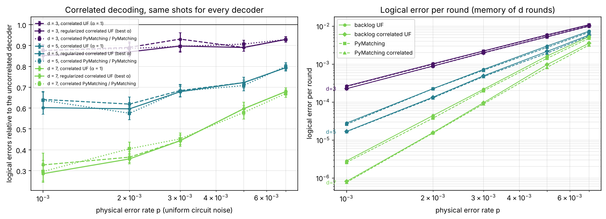

# backlog

**A real-time quantum error correction decoder: weighted Union-Find for the
surface code, with correlated decoding, streaming window decoders and Stim and
sinter integration.**

- As fast as PyMatching on one core, within 0 to 20% of its accuracy.
- Correlated (two-pass) decoding, with the regularized rule of
  [arXiv:2610.26785](https://arxiv.org/abs/2610.26785): 32 to 67% fewer
  logical errors than plain Union-Find at d = 7, within a few percent of
  PyMatching's correlated matching, faster than it from d = 13.
- Sliding-window and parallel-window decoders for streaming.
- Tested edge for edge against a reference implementation, with exhaustive
  fault enumeration, ThreadSanitizer and mutation testing.

```bash
pip install backlog-qec
```

```python
import backlog, stim

circuit = stim.Circuit.generated("surface_code:rotated_memory_z", distance=5, rounds=5,
                                 after_clifford_depolarization=0.003)
dets, obs = circuit.compile_detector_sampler().sample(100_000, separate_observables=True)

decoder = backlog.UnionFindDecoder.from_circuit(circuit, correlated=True)
print("logical error rate:", (decoder.decode_batch(dets) != obs).any(axis=1).mean())
```

As sinter decoders: `backlog-uf`, `backlog-uf-corr` (pass
`custom_decoders=backlog.sinter_decoders()`).



Results, how it works and how to reproduce everything:
[github.com/jcedrik/backlog](https://github.com/jcedrik/backlog) ·
[quickstart notebook](https://github.com/jcedrik/backlog/blob/main/examples/quickstart.ipynb) ·
[how the decoder works](https://github.com/jcedrik/backlog/blob/main/docs/decoder.md) ·
[state of the art](https://github.com/jcedrik/backlog/blob/main/docs/related-work.md)

MIT license. To cite: [CITATION.cff](https://github.com/jcedrik/backlog/blob/main/CITATION.cff).
