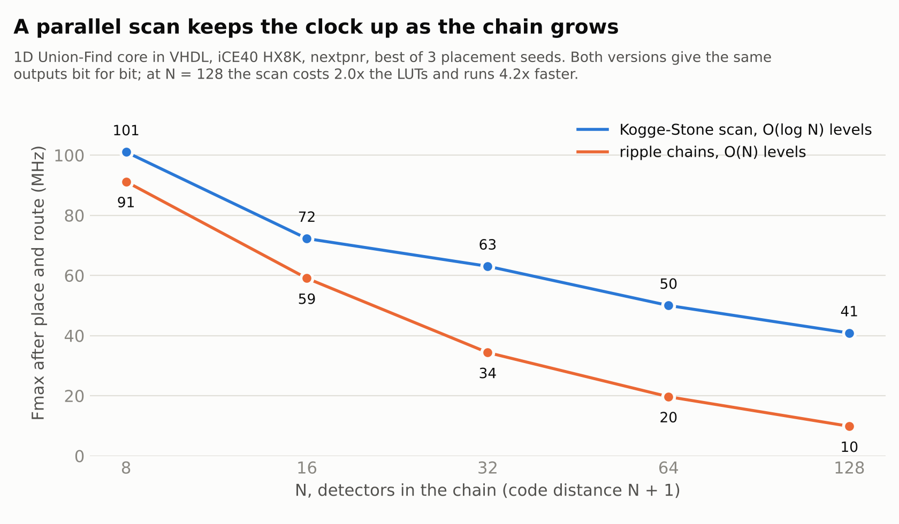

# Hardware: Union-Find decoder in VHDL

A synthesizable Union-Find decoder for a 1D chain (the repetition code), with
the full verification flow you would use on a real FPGA project:

```
golden model (Python) -> test vectors -> RTL simulation, bit-exact (ghdl)
                      -> synthesis (ghdl + yosys) -> place and route (nextpnr)
```

Reproduce everything with `./run_hw.sh` (about 10 minutes), or `./run_hw.sh sim` for the
simulation only (seconds, what CI runs).

## Results

All numbers below come from `./run_hw.sh` in this repo (`fmax.csv`).

**Verification.** For every size, and for both versions of the scan, the RTL
matches the golden model bit for bit (correction, logical flip, number of
growth rounds), and an independent check in the testbench confirms every
correction reproduces its syndrome.

| N (detectors) | d | vectors | mismatches | invariant failures |
|---|---|---|---|---|
| 8   | 9   | 2018 | 0 | 0 |
| 16  | 17  | 2034 | 0 | 0 |
| 32  | 33  | 2066 | 0 | 0 |
| 64  | 65  | 2130 | 0 | 0 |
| 128 | 129 | 2258 | 0 | 0 |

**Implementation.** LUT/FF counts from `yosys synth_xilinx` (7-series). Fmax
from a real place and route with `nextpnr-ice40` on an iCE40 HX8K, best of 3
placement seeds, with the decoder behind serial I/O (`rtl/uf_fmax_top.vhd`) so
that every size fits the package. The iCE40 is a slow, cheap FPGA: treat these
as a floor, not a target.

| N | scan | LUTs (xc7) | FFs | iCE40 LCs | Fmax (iCE40) | worst case (N+2 cycles) |
|---|---|---|---|---|---|---|
| 8   | parallel | 101  | 45  | 165  | 101.1 MHz | 99 ns |
| 8   | ripple   | 76   | 45  | 133  | 91.2 MHz  | 110 ns |
| 16  | parallel | 234  | 77  | 328  | 72.3 MHz  | 249 ns |
| 16  | ripple   | 158  | 77  | 255  | 59.1 MHz  | 305 ns |
| 32  | parallel | 504  | 141 | 729  | 63.1 MHz  | 539 ns |
| 32  | ripple   | 328  | 141 | 485  | 34.4 MHz  | 990 ns |
| 64  | parallel | 1288 | 269 | 1604 | 50.0 MHz  | 1.3 µs |
| 64  | ripple   | 637  | 269 | 968  | 19.7 MHz  | 3.4 µs |
| 128 | parallel | 2765 | 525 | 3615 | 40.9 MHz  | 3.2 µs |
| 128 | ripple   | 1365 | 525 | 1886 | 9.8 MHz   | 13.2 µs |



Typical case is much better than worst case: at a physical error rate of 8%,
the golden model needs on average 0.74 growth rounds at N=8 and 1.01 at N=16.

**Read this before comparing to anything.** This is the code-capacity
repetition code: one round of perfect measurements, bit flips only. It is not
the surface code with circuit-level noise, so these numbers are not comparable
to Helios, Riverlane's LCD or any 2D decoder. The point of this stage is the
flow (model, RTL, bit-exact, synthesis, P&R) and fixing the scaling bottleneck.

## The bottleneck, and the fix

The first version computed segment parity and boundary contact with prefix and
suffix XOR chains that ripple across the whole chain, so its critical path
grew with N: 4.0 ns of logic delay at N = 8, 20.3 ns at N = 64. Fmax fell
from 91 MHz to 9.8 MHz between N = 8 and N = 128.

Both chains are linear recurrences, so they can be computed as a parallel
prefix scan. The segment parity is L(v) = defect(v) xor (grown(v) and L(v-1)),
and the boundary contact is a running AND of the grown edges. Two steps
compose with an associative operator, (p1, x1) then (p2, x2) =
(p1 and p2, x2 xor (p2 and x1)), so a Kogge-Stone scan computes every L and
boundary bit in ceil(log2 N) levels, and the mirror image gives the suffix.
That is the default now (`PARALLEL => true`); `PARALLEL => false` keeps the
ripple chains as the baseline, and both pass the same vectors.

The logic delay on the critical path now barely moves: 3.4 ns at N = 8,
6.3 ns at N = 128. What is left is mostly routing (18.2 ns at N = 128): the
wires of a design that grows as N log N, on a small and slow FPGA. The scan
costs about twice the LUTs, and at N = 128 it runs 4.2 times faster. The
worst case still needs O(N) growth rounds, so worst-case latency goes from
O(N^2) to O(N log N) gate delays.

Next optimizations, in order:
1. Stop computing global info every round: only clusters that changed need
   updates (this is what distributed designs like Helios exploit).
2. Move to 2D (surface code) with the time dimension, driven by Stim data.

## Design

Layout (N detectors, N+1 data qubits, code distance d = N + 1):

```
 [B]--e0--(D0)--e1--(D1)-- ... --(D_{N-1})--eN--[B]
```

Edge k corresponds to data qubit k. Detector D(i) = e(i) xor e(i+1). The
logical observable is read on data qubit 0, so `obs_flip = correction(0)`.

Each clock cycle in `S_GROW` does one synchronous growth round:

1. Combinationally, for every vertex v: segment prefix parity L(v), suffix
   parity R(v), and boundary contact BL(v) / BR(v). Cluster parity is
   L(v) xor R(v) xor defect(v). A cluster is odd if its parity is 1 and it
   touches no boundary.
2. Every non-grown edge gains one half-edge per odd neighbour. Two halves make
   it fully grown (`half_r` and `grown_r` encode growth 0, 1, 2).
3. When no odd cluster remains, the peeling result is registered and `done`
   pulses for one cycle. `rounds` reports how many growth rounds were used.

Latency from the start pulse to `done` is rounds + 2 cycles.

The scans in step 1 are Kogge-Stone by default (see above): at level k,
detector v combines with detector v - 2^k (v + 2^k for the suffix), for
ceil(log2 N) levels.

## Why the peeling rule is always valid

Peeling is combinational. For a grown edge k:

- `k = 0` (left boundary edge): `c(0) = R(0)`
- `k = N` (right boundary edge): `c(N) = 0` if the segment also touches the
  left boundary, else `c(N) = L(N-1)`
- internal edge: `c(k) = R(k)` if the segment touches the left boundary,
  else `c(k) = L(k-1)`

Validity means: for every vertex v, the XOR of correction bits on its two
edges equals defect(v). Using L(v) = L(v-1) xor defect(v) and
R(v) = R(v+1) xor defect(v):

- **No boundary contact** (segment a..b, even parity, so L(b) = 0): inner
  vertices see L(v-1) xor L(v) = defect(v); the first sees L(a) = defect(a);
  the last sees L(b-1) = L(b) xor defect(b) = defect(b).
- **Left boundary** (rooted at the left boundary, peeled from the right):
  vertices see R(v) xor R(v+1) = defect(v); the last sees R(b) = defect(b);
  the left boundary absorbs R(0).
- **Right boundary only**: mirror image using L.
- **Both boundaries**: same as left boundary, with the right boundary edge
  dropped to break the cycle.

The testbench checks this property on every vector, independently of the
golden model.

## Files

- `model/uf1d_model.py`: golden model, test-vector generator, selfcheck vs PyMatching
- `rtl/uf_decoder_1d.vhd`: the decoder (VHDL-2008, generics `N` and `PARALLEL`)
- `rtl/uf_fmax_top.vhd`: serial I/O around the decoder, for the Fmax runs only
- `tb/tb_uf_decoder_1d.vhd`: self-checking testbench (vectors go to `build/`)
- `run_hw.sh`: the full flow; `fmax.csv` and `fmax.png` are its output
- `plot_fmax.py`: draws `fmax.png`
